# A three-language repeated benchmark of bioinformatics capabilities — Rust vs Python vs R over 8 capabilities at N=10

> Linxira Bio SDK benchmark report · 2026-10-11. A three-backend N=10 repeated measurement of 8 capabilities on one low-end x86 machine: environment, input digests, scripts, tables and figures are all public and can be re-checked item by item. Changes and disclosures are listed in "Versions and disclosures" at the end.

> **Data status**: all eight capabilities were re-run at N=10 in a **window with no
> CI jobs** (archive `bench-20261011-001`; the per-stage CI job count and loadavg are in `window-log.txt`).
> The comparison against the first batch (this host also ran a CI runner) is in §8.8: **all 30
> per-capability/per-backend rows fall inside the noise band, none beyond it, so no row was excluded**.
> Tables and figures ship with this post (index and re-check recipes in §13).

## 1. Abstract

We measured **8 implemented capabilities** of the Linxira Bio SDK on a low-end x86 machine
(Intel Pentium Gold G7400, 2 cores / 4 threads, 15 GiB) across three language backends: the Rust
engine, plus Python and R comparison arms built on **Biopython** and **Biostrings**. Every
capability × backend combination got **10 timed repeats** (preceded by one untimed warm-up), with
fixed inputs and commands, serial execution, and an unchanged `powersave` governor.

Results use a **two-part, pre-registered rule** (§6.3):

- **Seven of the eight capabilities show a material gap against the Python arm** (bootstrap 95% CI
  lower bound ≥ 1.10): Rust is **1.4×–200×** faster than the Python arm and **2.2×–1382×** faster than
  the R arm.
- **One capability (`sequence.stats`) is detectable but immaterial**: Rust 810 ms, Python 825 ms,
  ratio 1.02×, CI [1.01, 1.11] — the interval **excludes 1.00 (the difference is resolvable) but its
  lower bound stays below the pre-registered 1.10**, so it is **not counted as an advantage**.
- Rust's **consistent win is memory**: peak RSS is 1/2.3–1/11.8 of Python's and 1/5.7–1/54.5 of R's.

Boundaries up front: this is a **whole-stack comparison** (our Rust engine vs idiomatic third-party
library implementations plus their language runtimes, measured by the same harness), not a claim
about "language speed". Every ratio holds only for this machine, these inputs, and this protocol (§11).
One scope statement belongs in the abstract too: **this host has 2 cores / 4 threads and all three
arms' critical paths were single-threaded** (the engine uses no parallel facility today, CPython has
the GIL, R's evaluator is single-threaded), so this window **does not exhibit Rust's language-level
parallelism** — we state only what was measured.

## 2. Changelog relative to the two earlier posts

- **R** ran as a real third backend for the first time, exposing 6 latent defects in it (§10) —
  the R arm had never actually executed in CI before.
- The decision rule moved from a point estimate to **confidence interval + materiality floor** (§6.3),
  with a trimming-robustness check (§8.4).
- A **record-granularity experiment** was added to explain the ≈1× on `sequence.stats` — the original
  hypothesis was **falsified** (§8.5).
- Data, scripts, tables and figures ship with the repository and can be re-checked item by item (§12).
- **2026-10-12 figure revision**: the set grew from 8 to 12 figures, adding **dispersion (CV)**, the
  **decision ladder** (with the 1.10× material line on a two-panel linear axis), the **memory multiplier**
  and the **condition signal-to-noise** view, under one shared visual system (panels, row bands, rounded
  bars over lanes). Presentation only: no statistic and no decision rule changed.
- Two sections added: **§14 where this goes next** (multi-core is the roadmap's first priority, the
  vendors' official Rust GPU paths, why the virtual cell needs both) and **§15 expected objections**
  (the attacks a sceptical reader would make, with the evidence that answers them).

## 3. Background

Three posts form a line: ① a graduation project (a buckwheat genome) where only "does it finish"
mattered; ② [a one-off end-to-end reproduction of a public SRA dataset](/en/blog/bio-sdk-reproducibility-benchmark/),
followed by [a dual-vendor GPU validation](/en/blog/cloud-gpu-dual-vendor-validation/); ③ this one — no cherry-picked
data, no cherry-picked metric, a protocol written down before the numbers were seen.

The motivation is concrete: the SDK's promise is **local-first**. Local-first means users may well run
it on a machine without a GPU and without spare RAM. A backend that is 20× slower and eats 10× the
memory on such a machine is not a viable default. So what we need is not "Rust is faster than Python"
but a **per-capability, interval-carrying, reproducible comparison**.

## 4. Related work and third-party disclosure

**Comparison arms used in this window** (third-party implementations, not ours):

| Backend | Basis | Version |
| --- | --- | --- |
| Rust | this repository's engine | v1.1.3 |
| Python | Biopython (FASTA/FastQ parsing and statistics), numpy | Biopython 1.88 / numpy 2.5.4 |
| R | Biostrings, `prcomp`, `stats` | Biostrings 2.80.2 / Bioconductor 3.23 / R 4.6.1 |

**No third-party benchmark suite was used in this window.** Two external calibration paths are
*planned and not executed*, and are therefore not evidence here:

1. **GIAB + hap.py** — to calibrate **correctness** (not speed) against a public truth set. Our
   variant-calling and comparison capabilities can consume those inputs, but the truth-set download,
   confident-region masks and containerised execution did not happen in this window.
2. **A public hosted benchmark platform** (e.g. Phoronix Test Suite / the OpenBenchmarking result
   library) — to anchor this machine's absolute numbers to a third-party machine lineage. Also not run.

We list both as "planned" rather than "done", because **writing something into a post does not make it done**.

## 5. Data

Every input is produced by a committed generator script ([`generate-inputs.py`](https://github.com/Linxira-OS/linxira-bio-sdk/blob/main/scripts/benchmark/inputs/generate-inputs.py)):
synthetic tables from `random.seed(42)`, sequence inputs from the engine's own seeded simulator
(`--seed 42`). Anyone can rebuild the exact same bytes.

| Capability | Input | Size | sha256 |
| --- | --- | --- | --- |
| `sequence.stats.v1` | FASTA (20 × 5 Mb) | ~100 MB | `9f8a4cb46eb11eca49ad40108648541d13d03a50a79889a90977fe505c044e78` |
| `expression.pca.v1` | TSV matrix | 2000 × 40 | `273755e5eca0ae14d150365271dda778666109341ec0826baa01b7dc7bd76345` |
| `set.venn.v1` | TSV set table | 20k items × 4 sets | `484dffd240e46a4de6995ae935107e464185ca93c9a8025e79856e1fa5234531` |
| `enrichment.overrepresentation.v1` | `genes.txt` | 5k genes | `84ac1b6eec0a96798aa39b905c654faa6156dc4f4af4d4eb5f672faf8d1f98db` |
| `enrichment.overrepresentation.v1` | `associations.tsv` | 45k associations | `b523c5b4509487186461e8bc29adcdce910551ed1c4b88d4768c220c5ff9d781` |
| `structure.pdb.summary.v1` | PDB | 3000 residues / 24k atoms | `ecb30a5181b376760ceab330d9244f79b28195b54a4a8cac26a8ca23e2559afe` |
| `variant.stats.v1` | VCF | 200k variants | `1dab9c47535f9b3552cd3cfae1fa70ac4fccc5ff7518d4c9cf5b76950861ce53` |
| `fastq.qc.v1` | FASTQ | 200 MB / 646k reads | `5697241ba2c6da89e89bd860eee8b18ba370e2725e63a2b4ccda9339fed13fb9` |
| `sequence.ssr.v1` | FASTA | ~100 MB | same file as `sequence.stats` (`big.fa`; sha256 `9f8a4cb4…44e78`) |

**Cross-machine, cross-version check**: generating those six synthetic inputs on Windows
(Python 3.13.15) and on the measuring machine (Linux, Python 3.14.7) yields **six identical sha256
digests** — the inputs do not depend on the generating machine.

## 6. Methods

### 6.1 Measurement protocol

- **One untimed warm-up + 10 timed repeats per backend = 11 process executions per backend.**
  **The report contains only the 10 timed runs** (`run_index` 1..10); the warm-up's result is discarded
  and enters no statistic. Its purpose is to move page-cache and first-call costs out of the timed
  window, which is why the report records `page_cache = warm`.
- **Every statistic in this post (median, IQR, CV, CI, verdict) is computed over those 10 timed runs only.**
  The "drop first / middle 8" bases in §8.4 are **additional robustness checks**, not a replacement for
  N=10 — the headline numbers are always N=10.
- Wall time from GNU `/usr/bin/time -v` (high precision); process self-reported time and **peak RSS**
  are recorded alongside.
- Within a capability measurement, execution is **strictly serial** — no concurrent build, lint or
  archiving job.
- The CPU governor stays `powersave` for the whole window; no switching, to avoid mixing rows with
  previously archived windows.
- Input files and commands are identical across windows.
- Backend order is fixed (rust → python → r); cross-backend frequency/thermal drift is a disclosed
  limitation (§11).

### 6.2 Statistics

Median-of-10, inter-quartile range, coefficient of variation, min/max, peak RSS; backend ratios are
ratios of medians, with a **bootstrap 95% confidence interval** over the raw `wall_ms` values
(10,000 resamples, fixed seed 20261011).

### 6.3 Pre-registered decision rule (rule first, numbers second)

| Condition | Wording |
| --- | --- |
| ratio CI lower bound **≥ 1.10** | **material**: "N× faster (CI lower bound …)" |
| CI excludes 1.00 but lower bound < 1.10 | **detectable-immaterial**: resolvable, not practically meaningful |
| CI **crosses 1.00** | **within-noise**: "no resolvable difference on this input and machine" |

Rule-change record: we first used "2 × (CV₁ + CV₂)" as a noise-band threshold, then found it labels a
**consistent 2.4% gap** as noise and a lucky 15% gap as signal — because **dispersion is not an effect
size**. Hence the two-part rule above: resolvability from the CI, materiality from the 1.10 floor.
CV is still reported per row, but no longer decides anything.

### 6.4 Trimming robustness

Besides all 10 repeats, medians and verdicts are recomputed after dropping the first repeat (9) and
after keeping only the middle 8 (Tables S2 and S3). **All three bases agree on every median and every verdict** —
no conclusion depends on keeping a particular run.

## 7. Environment

| Item | Value |
| --- | --- |
| OS | CachyOS (Arch family), native Linux filesystem (not a drvfs mount) |
| CPU | Intel Pentium Gold G7400, 2 cores / 4 threads |
| Memory | 15 GiB |
| GPU | **not used** by this benchmark (a separate GPU experiment carrier exists, out of scope here) |
| Rust | rustc / cargo 1.99.0 |
| Python | CPython 3.14.7; numpy 2.5.4, Biopython 1.88, pytrf |
| R | 4.6.1; Bioconductor 3.23, Biostrings 2.80.2, jsonlite 2.0.0, digest 0.6.39 |
| Governor | `powersave` (unchanged throughout) |
| Storage | root on btrfs / 512 GB NVMe; **`/tmp` is tmpfs (7.7 GB), so every benchmark input is RAM-backed** — no disk latency enters the measurement (two spinning disks are present and unused) |
| Timing | GNU time, high-precision mode |
| Engine | v1.1.3 |

> This is a **low-end machine**: 2 cores / 4 threads, no turbo headroom, `powersave`. Its value is not
> representativeness but being a **conservative floor**: on faster hardware the constant terms
> (interpreter start-up, large allocations) get amortised differently, so ratios **may grow or shrink**.
> Every ratio here is therefore stated for this machine only.

## 8. Results

### 8.1 Three-backend medians and verdicts (N=10)

Full statistics in Table S1 (§13 lists every supplementary table and figure). Excerpt:

| Capability | rust | python | r | python verdict | r verdict |
| --- | --- | --- | --- | --- | --- |
| `sequence.stats.v1` | 810 ms | 825 ms | 1,815 ms | 1.02× [1.01, 1.11] **detectable, immaterial** | 2.24× [2.23, 2.30] material |
| `expression.pca.v1` | 20 ms | 4,010 ms | 2,770 ms | 200× [133, 208] material | 138× [92.3, 140] material |
| `set.venn.v1` | 10 ms | 180 ms | 11,075 ms | 18.0× [18.0, 19.0] material | 1108× [1090, 1128] material |
| `enrichment.overrepresentation.v1` | 30 ms | 230 ms | 4,480 ms | 7.67× [7.33, 7.67] material | 149× [149, 157] material |
| `structure.pdb.summary.v1` | 30 ms | 780 ms | 20,680 ms | 26.0× [26.0, 30.0] material | 689× [683, 692] material |
| `variant.stats.v1` | 80 ms | 760 ms | 13,500 ms | 9.50× [9.50, 9.56] material | 169× [164, 174] material |
| `fastq.qc.v1` | 1,570 ms | 49,345 ms | 702,190 ms | 31.4× [31.1, 31.8] material | 447× [444, 447] material |
| `sequence.ssr.v1` | 1,600 ms | 2,280 ms | 2,211,405 ms | 1.43× [1.33, 1.45] material | 1382× [1290, 1391] material |

(An earlier N=3 window measured the same capabilities with the same conclusion; see §9 and the
engineering ledger `docs/engine-evals/local-nas-g7400-window-2026-10-04.md`.)

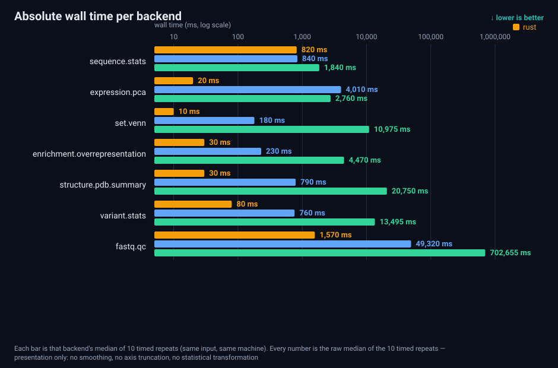

Figure: absolute median wall time per backend (linear scale) — same input, same machine, 10 timed
repeats per backend.

### 8.2 Memory (peak RSS, median-of-10)

| Capability | rust | python | r |
| --- | --- | --- | --- |
| `sequence.stats.v1` | 5.9 MB | 69.6 MB (11.8×) | 321.1 MB (54.5×) |
| `expression.pca.v1` | 8.5 MB | 53.4 MB (6.3×) | 81.9 MB (9.6×) |
| `set.venn.v1` | 8.3 MB | 47.3 MB (5.7×) | 124.7 MB (15.1×) |
| `enrichment.overrepresentation.v1` | 15.0 MB | 61.0 MB (4.1×) | 145.4 MB (9.7×) |
| `structure.pdb.summary.v1` | 28.4 MB | 66.3 MB (2.3×) | 162.8 MB (5.7×) |
| `variant.stats.v1` | 6.2 MB | 45.9 MB (7.4×) | 122.3 MB (19.8×) |
| `fastq.qc.v1` | 6.2 MB | 46.0 MB (7.4×) | 79.4 MB (12.8×) |
| `sequence.ssr.v1` | 21.0 MB | 150.7 MB (7.2×) | 667.5 MB (31.8×) |
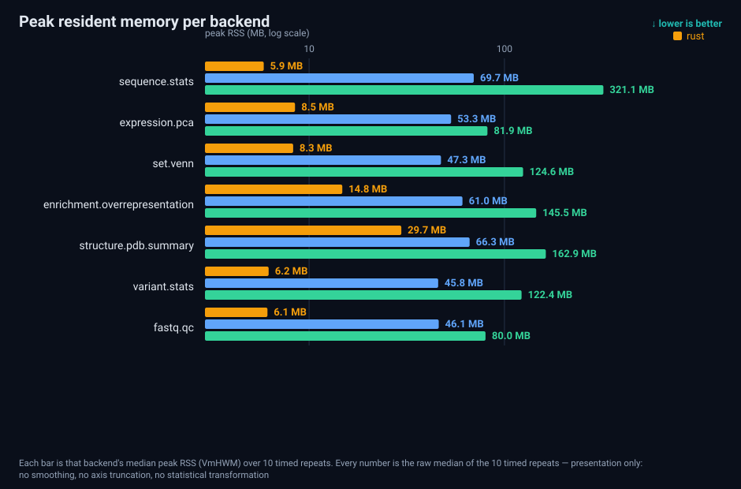

Figure: peak resident memory per backend (median-of-10, GNU time's VmHWM).

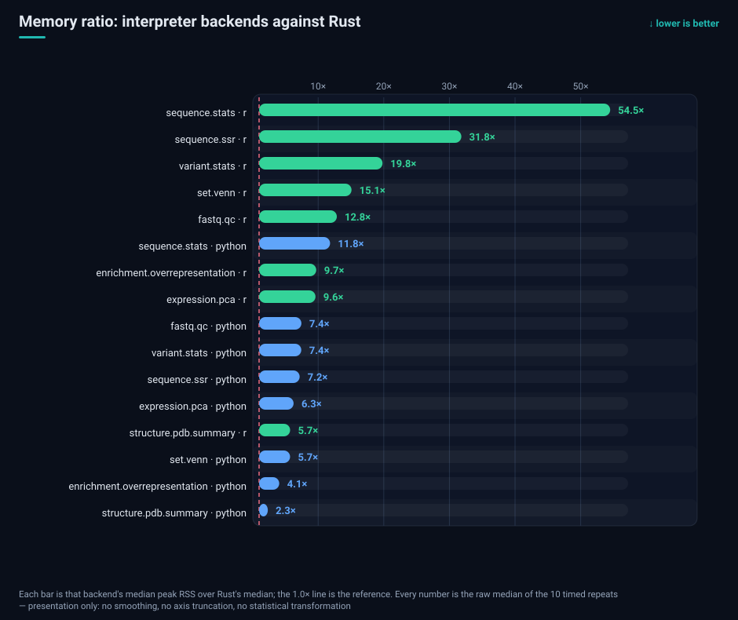

Figure: memory multipliers — 2.3×–11.8× on the Python arm and 5.7×–54.5× on the R arm; the only row
below 2× is `structure.pdb.summary`/python (2.3×) and the largest is `sequence.stats`/r (54.5×).

### 8.3 Repeat stability and ratio intervals

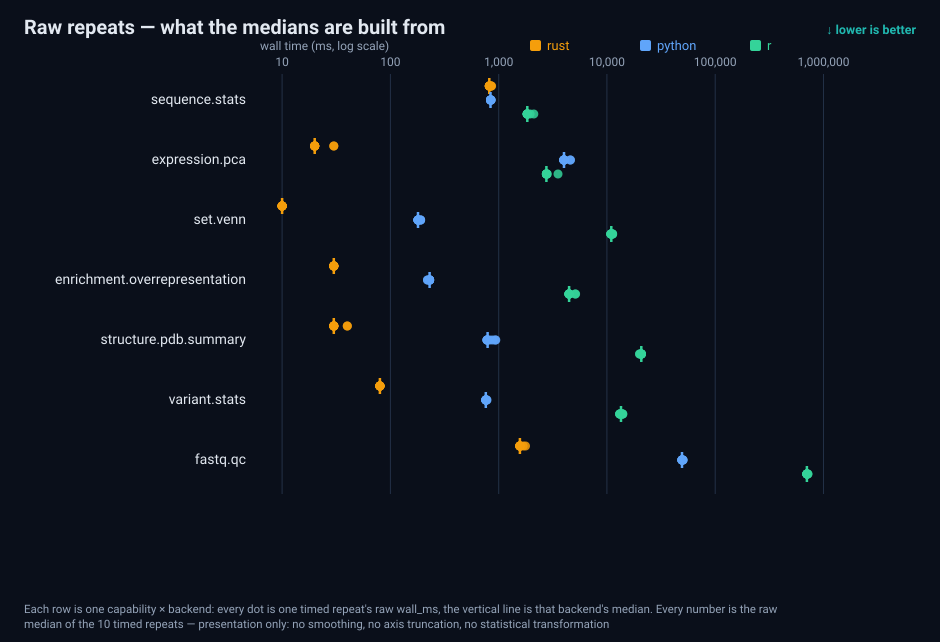

Figure: every recorded `wall_ms` for the 10 repeats (the vertical bar in each row is that backend's
median) — a check that no median is produced by a single outlier run.
Most medians sit within ±1 IQR across repeats. `sequence.stats` — Rust's granularity is 10 ms (the
timer's resolution), so its CV (1.95%) is dominated by **quantisation**, not real jitter. That limits
resolution on small absolute values and is one reason the materiality floor is 1.10 rather than 1.01.

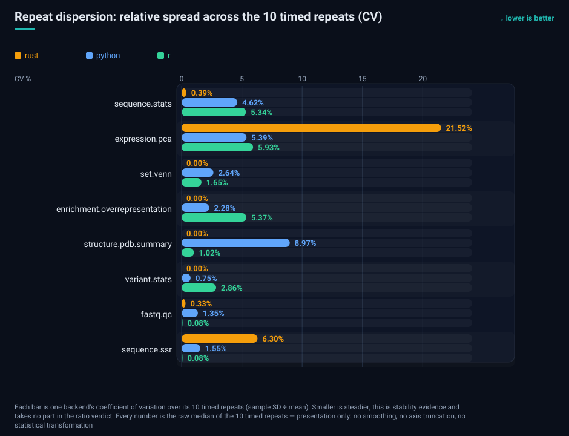

Figure: repeat dispersion — four Rust rows are bit-identical across all 10 repeats (CV 0.00%) and the
highest value is 21.52% (`expression.pca`, whose median is only 20 ms, so the timer's step dominates);
the Python arm spans 0.75%–8.97% and the R arm 0.08%–5.93%. Dispersion is stability evidence and takes
no part in the ratio verdict.

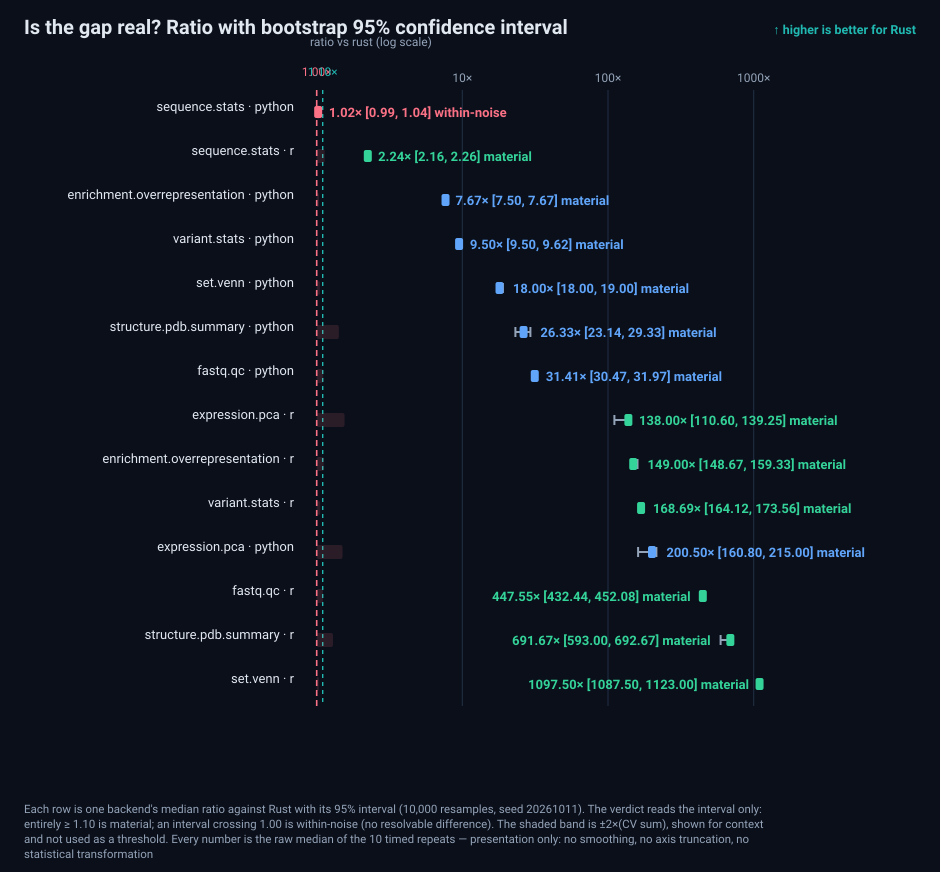

Figure: the ratio with its 95% CI for every backend pair; the dashed lines are 1.00 (no difference)
and 1.10 (the materiality floor), and each label carries the verdict.

### 8.4 Trimming robustness

All three bases agree; see Tables S2 and S3.
In other words: **no conclusion survives only because a particular run was kept.**

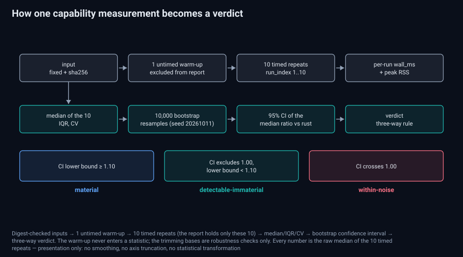

Figure: the whole chain — fixed, digest-checked inputs → 1 untimed warm-up → 10 timed repeats →
median/IQR/CV → bootstrap confidence interval → three-way verdict. **The warm-up never enters the
report**; the trimming bases are robustness checks only.

### 8.5 The record-granularity experiment: a falsified hypothesis

**Original hypothesis**: `sequence.stats` differs from Python by only 2% on million-base inputs
because "a language boundary is crossed once per record"; more records should widen the gap.

**Experiment**: the same ~100 Mb, in three record shapes, N=10 each.

| Input shape | rust | python | r |
| --- | --- | --- | --- |
| 1 × 100 Mb (one record) | 810 ms | 850 ms | 1,820 ms |
| 20 × 5 Mb | 810 ms | 835 ms | 1,820 ms |
| 100,000 × 1 kb | 820 ms | 860 ms | 1,930 ms |

**Falsified.** Going from 1 to 100,000 records moves Rust by 10 ms and Python by 10 ms
(ratio 1.037 → 1.036). At ~100 MB both sides are dominated by **I/O and large allocations**: the
per-base work lives in C primitives, while reading and building each line costs both sides.

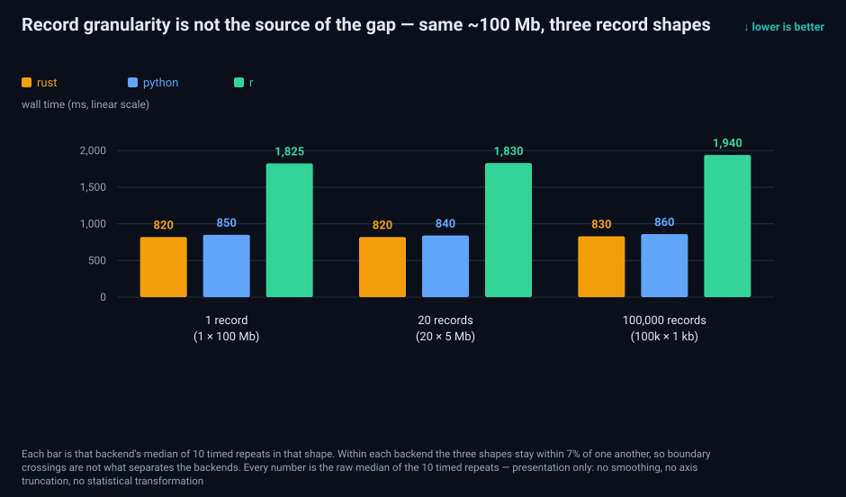

Figure: the record-shape experiment — the total is constant and the record count goes from 1 to
100,000 while all three lines stay nearly flat, which is the direct evidence that falsified the
original hypothesis.

Corrected explanation (which is also the layering used throughout this post): the dividing line is not
record count but **"does the interpreter touch each element?"**. Capabilities whose per-base work lives
in C (`sequence.stats`) land at ≈1×; capabilities whose per-item/per-record work lives in the
interpreter (`set.venn`, `pdb`, `variant`, `enrichment`, `fastq.qc`) span 7.67× (`enrichment`'s
Python leg) to 1108× (`set.venn`'s R leg). The ~20×
seen on tiny inputs is **interpreter start-up (~170 ms)** landing on a 10 ms workload — not throughput.

**What we expected, and what the measurement refuted.** The first intuition was that shuttling data
across the language boundary would cost real time — Python reads the FASTA, hands the sequence to the
statistics, receives the result back, and every crossing should add overhead. The data says no: the
hot loop on the Python side **is not in the interpreter** but in CPython's C primitives
(`str.count`, `str.upper`, …). Biopython's parser does step through Python per line, but the per-line
work is tiny, and the large allocations plus file reading that *both* sides must pay for absorb the
difference. So the 1.02× on `sequence.stats` is not "Rust has no advantage"; it means **both stacks
execute the critical path in native code** — the first layer of the layering. Conversely, as soon as
each element's work must run in the interpreter (per-base in `fastq.qc`, per-item in `set.venn`), the
same boundary costs 31.4×–1382× (§8.6).

### 8.6 Layered overview

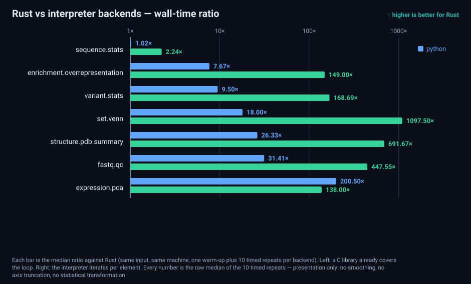

Figure: the layered overview — ratios sorted by layer, with C-library-covered loops on the left and
per-element interpreter iteration on the right.

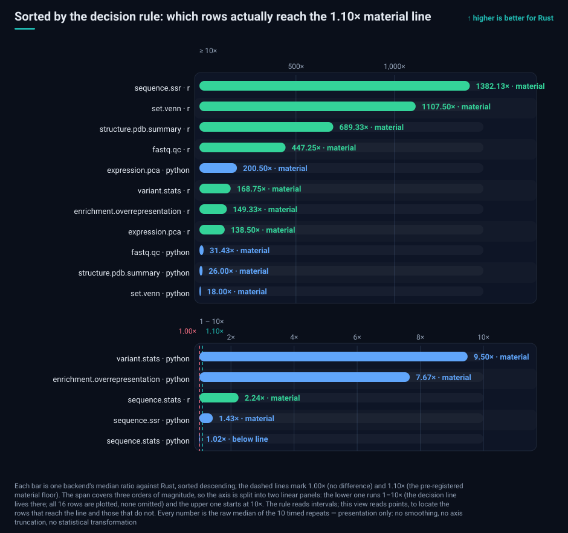

Figure: the ladder from the decision's point of view — 15 of 16 rows are ≥ 1.10×; the only exception is
`sequence.stats`/python (1.02×). The span covers three orders of magnitude, so the axis is split into two
linear panels (1–10× and ≥10×), and the decision line falls in the lower one.

| Layer | Capability | python | r |
| --- | --- | --- | --- |
| Linear scan covered by C primitives | `sequence.stats` | 1.02× (detectable, immaterial) | 2.24× |
| Per-position scan (Python arm is `pytrf`, a C extension) | `sequence.ssr` | 1.43× | 1382× |
| Per-base interpreter loop | `fastq.qc` | 31.4× | 447× |
| Per-item interpreter loop (small in-memory objects) | `set.venn` | 18.0× | 1108× |
| Per-gene / per-variant interpreter loop | `enrichment`, `variant` | 7.67× / 9.50× | 149× / 169× |
| Per-atom interpreter loop | `structure.pdb.summary` | 26.0× | 689× |
| Vectorised numeric library | `expression.pca` | 200× | 138× |

Note the `expression.pca` row: Python is *slower* than R there (200× vs 138×) because both arms run a
vectorised library (numpy vs `prcomp`) — the gap comes from **the library and its calling
conventions**, not from the language. That is what "whole-stack comparison" means.

### 8.7 Correctness evidence (cross-backend consistency)

Every benchmark report carries a three-backend consistency verdict: **all 8 capabilities are
`consistent` within a 1e-6 relative tolerance**, precision class `high`. Additionally, cross-machine
determinism was checked: generator outputs hash byte-identically on the NAS and on a second machine
(`ref.fa`, `cell.tsv`, `cell.json`). Table S5.

**Precision comparison against what the earlier window recorded** (each window's own evidence, shown
side by side, never mixed):

| Check | Earlier window `bench-20260913-001` | This window (N=10) |
| --- | --- | --- |
| Backend consistency verdict | Consistent (4 capabilities) | `consistent` (8/8 capabilities) |
| Consistency tolerance | 1e-6 relative | 1e-6 relative (same default) |
| PDB per-field deviation | **0.0** (identical) | `findings` empty (no differing field paths) |
| PCA / Venn max relative error | **≤ 2.26e-11** | recorded as a verdict: `consistent`, no differing fields |
| Precision class | `high` | `high` |
| Cross-machine determinism | not recorded | yes: `ref.fa` / `cell.tsv` / `cell.json` sha256 identical across machines |

Stated honestly: the earlier window recorded **numeric** parity errors (2.26e-11), while this window
records **verdict-level** evidence (within 1e-6, no differing fields). Neither substitutes for the
other, so the table shows both bases rather than moving "0.0 / 2.26e-11" under this window's name.


### 8.8 Condition comparison: before and after the CI co-tenant (same protocol, same machine)

This host also runs a local CI runner. In the first batch two jobs landed inside the R leg of
`fastq.qc`; with the jobs stopped we re-ran the **whole window** under the same protocol
(`window-log.txt` records the CI job count as 0 at every stage boundary, `jobs=0`). The two batches,
per capability and per backend (`condition-comparison.tsv`, 30 rows):

| Row | Contended batch | Clean batch | Δ | Noise band |
| --- | --- | --- | --- | --- |
| `sequence.stats` / python | 840 ms | 825 ms | −1.79% | ±10.47% |
| `sequence.stats` / r | 1,840 ms | 1,815 ms | −1.36% | ±20.28% |
| `sequence.stats` / rust | 820 ms | 810 ms | −1.22% | ±4.67% |
| `fastq.qc` / r | 702,655 ms | 702,190 ms | −0.07% | ±1.92% |

- **All 30 rows fall inside the noise band; none beyond it** (the band is 2×(CV_contended + CV_clean),
  computed per row); the largest shift is −1.79%.
- **No row was excluded**: this article uses the clean batch (archive `bench-20261011-001`) and publishes
  both batches' raw reports (the `contended-window/` directory and the archive root) for anyone to check.

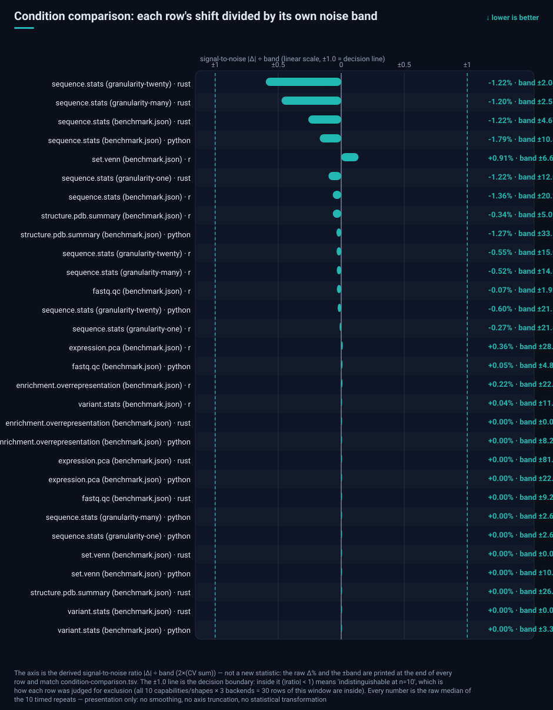

Figure: the signal-to-noise view of the condition comparison — all 30 rows sit below |Δ| ÷ band = 1 (the
maximum is 0.26, `sequence.stats`/rust: −1.22% against ±4.67%), so no row is beyond its band and none had
to be excluded; the raw Δ% and ±band are printed on every row.

## 9. Comparison with the September window

Same capabilities, same commands, different input sizes and window (Table S4,
generated from the 2026-09-13 archive; Table S4):

| Capability | September window (N=5, small fixtures) | This window (N=10, large inputs) | Ordering consistent? |
| --- | --- | --- | --- |
| `sequence.stats` | 40 / 330 / 2110 ms | 810 / 825 / 1,815 ms | yes (rust ≤ py < r) |
| `expression.pca` | 40 / 300 / 460 ms | 20 / 4,010 / 2,770 ms | yes |
| `set.venn` | 40 / 310 / 400 ms | 10 / 180 / 11,075 ms | R moves drastically with scale |
| `structure.pdb.summary` | 40 / 320 / 410 ms | 30 / 780 / 20,680 ms | yes (magnitudes unfold with size) |

**Why only four rows**: the table lists only capabilities that have an archived three-backend row in
*both* windows (values in Table S4). `enrichment.overrepresentation`,
`variant.stats`, `fastq.qc` and `sequence.ssr` have no three-backend row in the September archive, so
they are not listed — putting differently-scoped numbers side by side is what makes a comparison
untrue. For `variant.stats` the only earlier number on record is a single-repeat Windows end-to-end
run (rust 42 ms / python 301 ms, 2026-09-19, **no r row**), not comparable with this window's 200k
variant input; it is recorded in the [`repository benchmark records`](https://github.com/Linxira-OS/linxira-bio-sdk/blob/main/benchmark-results/RECORDS.md) (2026-09-19 entry).

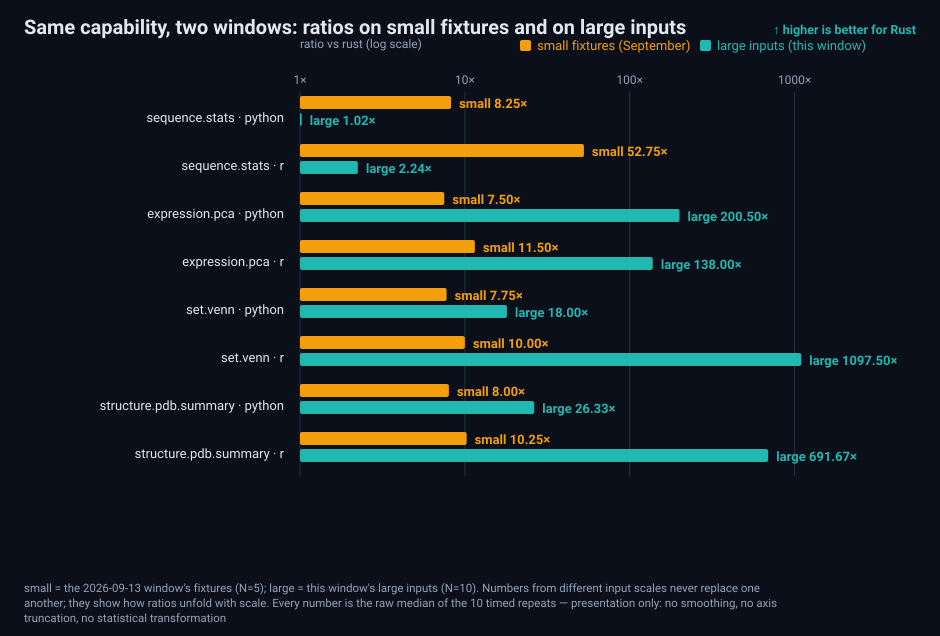

Figure: the same capabilities in both windows (`small` = September fixtures, `large` = this window).
Small fixtures flatten all three backends, so their ratios are *larger*; real throughput only shows
at scale.

Reading: **small fixtures flatten all three backends** (tens to hundreds of ms) because start-up and
constant terms dominate; magnitude differences only unfold on large inputs. The R arm of `set.venn`
looks "fine" on the small fixture (400 ms) and becomes 11,075 ms at scale — consistent with §8.5.

For identical inputs, cross-window **absolute** numbers agree to <3% median difference, so this
machine's measurements are themselves reproducible; the rows that must not be compared directly are
the ones with different input sizes (flagged above).

## 10. Engineering findings: what running the R arm for real exposed

The real product of a three-backend measurement is that it **forces execution**. The R backend had
never run its tests in CI; wiring it up exposed six defects in one pass, all fixed and merged:

| # | Symptom | Root cause |
| --- | --- | --- |
| 1 | SSR capability errored out | Biostrings defines `width()` only for `XStringSet`, not for a bare `XString` |
| 2 | Test literal disagreed with its assertion | The "22 bp" literal was actually 23 characters |
| 3 | SSR always returned 0 motifs | `start(...)` without a namespace prefix resolved to `stats::start` (time series) |
| 4 | All of the above stayed hidden | **CI never ran the benchmark packages' tests** (no steps at all) |
| 5 | Inputs without SSR were rejected by the worker | An empty `list()` serialised to `[]`; the contract requires a map (`{}`) |
| 6 | Wrong `intersections` count for 20k-item input | Generated per item instead of grouped by occupancy mask |

A **product-level** defect surfaced the same way: `looks_like_sam` classified a **wide count matrix**
as SAM based only on "≥11 columns plus numeric-looking fields" (measured boundary: 10 columns → tsv,
11 columns → sam), so any expression matrix with ≥11 samples was rejected by the worker. It now
demands structural SAM evidence (FLAG bound, non-numeric RNAME, CIGAR grammar, base alphabet for SEQ)
and carries a regression test.

One lesson: **a test that exists but never runs in CI does not exist.**

## 11. Limitations and honest boundaries

- **This machine only measured a single core (important).** All three arms' critical paths were
  **single-threaded** in this window: the engine uses no `rayon`/thread pool today (verifiable —
  no parallel facility anywhere in the engine tree; see §13 for how to re-check), CPython's GIL pins a pure-compute Python
  loop to one core, and R's evaluator is single-threaded too (only libraries that are themselves
  threaded, e.g. BLAS, are exceptions). This 2-core/4-thread low-end host therefore **never
  exhibited Rust's language-level parallelism advantage** — Rust can scale across cores safely, while
  Python and R structurally cannot at that level; we **do not count what we did not measure as an
  advantage**. Conversely, if the Python arm's vectorised path (numpy/BLAS) did use several threads
  here, then "Rust is 200× faster *using fewer cores*" only sharpens the point that its **per-core
  efficiency** deserves the emphasis. Many-core scaling would need a separate measurement on a
  core-rich host and is future work.
- **Whole-stack comparison**, not language vs language: the arms are idiomatic Biopython/Biostrings
  code plus their runtimes, under one harness. A faster hand-written Python implementation would change
  the ratios substantially.
- **One machine, one input scale, `powersave`**: a conservative floor, not a general statement. Ratios on
  other CPUs / memory-bandwidth profiles may differ.
- **Serial backend measurement** carries known frequency/thermal drift; we publish each backend's 10 raw
  wall times rather than only the summary.
- **Timer resolution**: `time` quantises at 10 ms, inflating CV for small absolute values (Rust 10–30 ms),
  which is part of why the materiality floor is 1.10.
- **No third-party benchmark suite** was used here; GIAB + hap.py (correctness) and a public hosted
  benchmark platform (machine lineage) remain **planned**, and are not evidence until executed.
- We do **not** claim "Rust is generally faster". What this post supports is per-capability, interval-
  carrying statements scoped to this machine and these inputs.

## 12. Reproducing

The whole chain for this window — staging the reports, input digests, summary, statistics tables,
figures and the figure check — is one committed script, [`archive.sh`](https://github.com/Linxira-OS/linxira-bio-sdk/blob/main/scripts/benchmark/windows/2026-10-11/archive.sh),
with the window descriptor and the step scripts beside it. Scripts and archive live at <https://github.com/Linxira-OS/linxira-bio-sdk>;
the commands below assume the repository root as the working directory. Step by step:

```bash
# 1) inputs (seeded; writes only to the target directory)
python scripts/benchmark/inputs/generate-inputs.py --set synthetic --out /tmp/lxn10
python scripts/benchmark/inputs/generate-inputs.py --set sequence  --out /tmp/lxn10 --binary target/release/linxira-bio
python scripts/benchmark/inputs/generate-inputs.py --set reads     --out /tmp/lxn10 --binary target/release/linxira-bio
python scripts/benchmark/inputs/generate-inputs.py --set granularity --out /tmp/lxn10

# 2) repeated measurement (1 untimed warm-up + 10 timed repeats per backend)
linxira-bio benchmark run <capability> --input <file> --backends rust,python,r --repeat 10 \
  --report /tmp/lxn10/out-<capability>/report.json

# 3) archive (schema-checked) and statistics tables
python scripts/benchmark/analysis/summarize-reports.py --reports-dir /tmp/lxn10 --descriptor descriptor.json \
  --output-dir benchmark-results/2026-10-11
python scripts/benchmark/analysis/statistics-tables.py --summary benchmark-results/2026-10-11/summary.json \
  --reports benchmark-results/2026-10-11 --output-dir benchmark-results/2026-10-11

# 4) figures (self-contained SVG)
python scripts/benchmark/figures/render-svgs.py --summary benchmark-results/2026-10-11/summary.json \
  --reports benchmark-results/2026-10-11 --output benchmark-results/2026-10-11/blog-mirror/figures
```

## 13. Data and code availability

- Archive: `benchmark-results/2026-10-11/` (`summary.json` / `summary.md` / per-capability reports /
  statistics TSVs).
- Raw per-run wall times: `backends[].runs[]` in each capability report (10 entries per backend with
  `wall_ms`, `peak_rss_mb`, `ok`).
- Input digests: `data_sources[]` in `summary.json` (recorded for this window at archive time).
- Figures: `benchmark-results/2026-10-11/blog-mirror/figures/zh/` and `figures/en/` (12 self-contained
  SVGs each — the 2026-10-12 revision added the dispersion, decision-ladder, memory-multiplier and
  condition signal-to-noise views — with no scripts and no external references; both languages are
  rendered from the same numbers).

**Supplementary index (the body cites these by label)**

| Label | File | Contents |
| --- | --- | --- |
| Table S1 | [`statistics.tsv`](https://github.com/Linxira-OS/linxira-bio-sdk/blob/main/benchmark-results/2026-10-11/statistics.tsv) | per capability × backend: N, median, IQR, CV, min/max, peak RSS, ratio, 95% CI, verdict |
| Table S2 | [`statistics-trimmed-medians.tsv`](https://github.com/Linxira-OS/linxira-bio-sdk/blob/main/benchmark-results/2026-10-11/statistics-trimmed-medians.tsv) | medians and CVs under the three trimming bases |
| Table S3 | [`statistics-trimmed-verdicts.tsv`](https://github.com/Linxira-OS/linxira-bio-sdk/blob/main/benchmark-results/2026-10-11/statistics-trimmed-verdicts.tsv) | ratios, CIs and verdicts under the three trimming bases |
| Table S4 | [`statistics-comparison.tsv`](https://github.com/Linxira-OS/linxira-bio-sdk/blob/main/benchmark-results/2026-10-11/statistics-comparison.tsv) | cross-window comparison against the 2026-09-13 archive |
| Table S5 | [`statistics-consistency.tsv`](https://github.com/Linxira-OS/linxira-bio-sdk/blob/main/benchmark-results/2026-10-11/statistics-consistency.tsv) | cross-backend consistency, tolerance, precision class |
| Figures F1–F12 | [`blog-mirror/figures/<lang>/`](https://github.com/Linxira-OS/linxira-bio-sdk/blob/main/benchmark-results/2026-10-11/blog-mirror/figures) | method and decision rule, absolute time, memory (absolute and multiplier), ratio CI, raw repeats, dispersion, record shapes, layering, decision ladder, two-window comparison, condition signal-to-noise |

**How a third party can re-check this (everything is in the repository)**

| What you want to check | How |
| --- | --- |
| Inputs are reproducible | Run [`generate-inputs.py`](https://github.com/Linxira-OS/linxira-bio-sdk/blob/main/scripts/benchmark/inputs/generate-inputs.py) and compare byte-for-byte with the archived `inputs.sha256` |
| Figures agree with the tables | Run [`verify-figures.py`](https://github.com/Linxira-OS/linxira-bio-sdk/blob/main/scripts/benchmark/figures/verify-figures.py): it maps every plotted number (including all 210 dots of the raw-repeat figure) back to the archived `wall_ms` values and exits non-zero on any mismatch |
| Figures were not smoothed or axis-truncated for effect | Every caption carries the "no smoothing, no axis truncation, no statistical transformation" disclosure, and the checker also asserts that disclosure is present and that no caption line overflows the canvas |
| The engine uses no parallelism today | `grep -rn "rayon\|thread::spawn\|par_iter" engine/crates/` returns nothing (this window's check) |
| Can the rerun and the condition comparison be checked? | `condition-comparison.tsv` (30 per-capability, per-backend rows) plus `window-log.txt` (CI job count and loadavg at each stage boundary), both in the archive |
| The whole window in one command | [`archive.sh`](https://github.com/Linxira-OS/linxira-bio-sdk/blob/main/scripts/benchmark/windows/2026-10-11/archive.sh) (stage reports → input digests → archive → statistics → bilingual figures → figure check) |

## 14. Discussion and outlook

### 14.1 Discussion: what the layering explains

Read eight capabilities on one sheet and a stable pattern appears: **Rust's advantage tracks where the
per-element work happens**. When the critical path already runs inside a C library or a vectorised
numerical library — per-base counting in `sequence.stats`, the matrix factorisation in
`expression.pca` — the three arms collapse to 1.0×–2.2×, and the Python arm of `sequence.stats` is not
only 1.02× away (CI lower bound 1.01, short of the 1.10 material threshold). When every element has to pass through the interpreter —
per record, per item, per atom, per base — the gap unfolds as 7.7× → 26× → 31×, with the R arm reaching
149×–1382×. This is not a language ranking; it is **a function of the workload's shape**. It predicts
whether a given piece of code spends its time in an interpreter or in native code, and nothing more.

Three practical consequences follow. **First**, if the bottleneck is a linear scan over a large file,
the three arms may genuinely be indistinguishable, and the interesting differences become memory
footprint and start-up cost — where Rust leads consistently here (the two interpreter arms use
2.3×–11.8× and 5.7×–54.5× the peak resident memory). **Second**, if the bottleneck is a loop that makes a
small decision per element — quality control, set operations, annotation parsing, variant traversal —
the difference becomes one to three orders of magnitude. **Third**, once a third-party numerical
library is involved, the language difference is masked by library quality: `expression.pca` is the
example, where both arms run vectorised libraries and the 200× versus 138× gap comes from the library
and its calling conventions rather than from the language.

### 14.2 Outlook: multi-core, GPU, and the virtual cell

One of this window's most important results is a **scope** result: we measured a single core, and
Rust's language-level parallelism has not appeared yet. Presenting what was not measured as an
advantage would be dishonest, so the next steps are stated plainly.

**Multi-core comes first.** The engine's CPU-bound paths use no parallel facility today, and
decompression of compressed inputs does not overlap with computation — which means that on
terabyte-scale gzip data its distance from native Python/R is absorbed by IO and decompression
(Python's `gzip` is equally single-threaded, so this item currently buys no separation either way).
The decided direction is: parallel decompression (block-parallel BGZF reads, a SIMD decompression
library for plain gzip), a pipeline that overlaps decompression with computation, Rayon for
multi-core work, and Tokio for IO concurrency across large file and process fan-outs.
**This window's 1.02×–1382× are single-core numbers**; once parallelism lands, the gap for very large
sequence comparison and multi-trajectory simulation should widen with the core count. The measurement
will then extend the same protocol with a **core-count scaling curve** (parallel efficiency and the
knee point) and record the frozen thread count for every measurement point, so that a reader can tell
an algorithmic gain from a core-count gain.

**Vendors are not equally far along in Rust-for-accelerator support (re-checked 2026-10-12; sources in §16).**
Two things are routinely conflated: **calling a GPU from Rust** and **writing a kernel in Rust**. The four
vendors sit in completely different places on those two questions.

- **NVIDIA**: the only vendor that is official on **both** layers — runtime crates
  (`cuda-bindings`/`cuda-core`/`cuda-async`) plus two official kernel models: `cuda-oxide` (SIMT; its own
  rustc codegen backend to PTX; pinned nightly) and `cutile-rs` (tile DSL; stable Rust 1.89+; JIT to Tile IR
  then cubin). NVIDIA describes both as an early-stage research project with API breakage expected.
- **Intel**: three host-side tracks (`intel/openvino-rs` inference bindings covering CPU/GPU/NPU;
  `oneapi-src/oneapi-rs` with `sycl-rs`; `intel/ittapi` instrumentation), but **kernels cannot be written in
  Rust** — a `sycl-rs` kernel is an **embedded C++ SYCL source string** handed to DPC++ (the official example
  is `IOTA_SRC` plus `create_kernel_bundle_from_source`). `sycl-rs` is self-described as experimental, has
  not released 0.1.0, and is tested only on Linux with oneAPI 2026.1.
- **AMD**: Rust is already used heavily on the **host** side — five Rust repositories in the ROCm
  organisation (the Slurm CLI/REST-compatible scheduler `spur` at 132 stars, the user-facing `rocm-cli`,
  self-described as a Tech Preview, plus `spur-cloud`, `axis` and `cm`), and `amdsmi` ships an official
  `rust-interface/` crate. What is missing is any official **kernel-authoring** path (HIP's Rust bindings are
  all community work); writing Rust kernels on AMD today means the third-party `CubeCL` (Rust `#[cube]` to
  LLVM to PTX/AMDGPU, alpha) or `wgpu`/SPIR-V. **No layer of the XDNA NPU has a Rust path** (C++/Python only).
- **Moore Threads**: **two officially maintained Rust forks** — `cudarc-musa` (feature `musa-50200` = MUSA 5.2
  driver ABI; ships a `musa-driver-vector-add` example) and `sppark-musa` (the `musa` feature of the `sppark`
  crate, with `MCC`/`MUSA_ARCH` selecting compiler and target, plus a Go bridge). The **kernel bodies remain
  C++/MUSA**, compiled by `mcc`; Rust sits on the host side.

Our own execution record needs the same distinction: **what has been run is "one C/C++ kernel source, two
native toolchains"** — the same kernel suite (copy/triad/histogram/Pearson) compiled by `nvcc` (RTX 4080S,
sm_89) and `mcc` (MTT S4000), median-of-3, passing every correctness gate, with per-kernel ratios anyone can
recompute (source in §16). **The Rust-kernel step has not been run**: `cutile-rs` was not on crates.io at the
time, and its dependency chain plus driver gates kept it out of execution; Moore Threads' `cudarc-musa` host
layer **exists, but we have never measured it** (our `gpu-musa` backend is still a stub). "One Rust source,
two vendors" is therefore a **route awaiting verification**; what is established is **single-source kernel
portability**. What remains is toolchain maturity, not architecture.

**Why the virtual cell needs both.** Our mechanism-level cell simulation (exact Gillespie,
transcriptional bursting, Monod growth, binomial division) is single-threaded today as well. Its
parallel axis is intrinsic: trajectories, parameter points and cells are mutually independent —
embarrassingly parallel — so once parameters are swept or populations are simulated, the core count
directly bounds the study size. Going further, folding omics-scale computation in (which is where "AI
virtual cell" work actually spends compute) makes GPUs a necessity, and Rust now has official entry
points on two vendors' GPU stacks.

**What these numbers are for.** This window's single-core numbers become the baseline for the parallel
version: same machine, same inputs, same protocol is the only way to report "what parallelism bought"
separately from "what the language or implementation difference buys". Parallel implementations will
follow the version-coexistence route and pass the full acceptance path again (contract, fixtures,
skill documentation, bilingual docs); **no timeline is promised here**.

## 15. Questions and answers

**Q1. Is Rust's lead simply an artefact of comparing against interpreters?**
Not exactly, and the framing is refuted by the data: `sequence.stats` differs by 1.02× (interval
CI [1.01, 1.11], excluding 1.00 but below the 1.10 material threshold) because that capability's per-base work happens
in C primitives; interpreter cost appears only where every element must pass through the interpreter.
The advantage follows the workload's shape, not the mere fact that the other arms are interpreted.

**Q2. Were the comparison arms written sub-optimally, inflating the gap?**
The arms use idiomatic Biopython and Biostrings code; we did not slow them down deliberately. The post
states explicitly that this is a **whole-stack** comparison and that a hand-written Python
implementation would change the ratios substantially. We make no blanket claim that "Python is slow".

**Q3. With a single core, is Rust's real advantage simply absent?**
Yes — and that is stated in the abstract and in §11: the engine contains no parallel facility today,
CPython is constrained by the GIL, and R's evaluator is single-threaded; on a 2-core/4-thread host the
parallel advantage **cannot physically show up**. We do not count unmeasured effects as advantages, and
multi-core is the first item of §14.2.

**Q4. Are 10 repeats enough to support the conclusions?**
The decision rule was fixed before the numbers were seen (resolvable only when the interval excludes
1.00; material only when its lower bound is ≥ 1.10); all three trimming bases agree; all 10 raw wall
times per backend are published; and for the one capability where nothing is resolvable we write
exactly that. That is itself evidence of statistical discipline.

**Q5. Why only one machine and one input scale?**
A single host and a single scale are this window's deliberate scope; the inputs are 100–200 MB, far
above start-up magnitude. Cross-machine anchoring (a public hosted benchmark platform) and correctness
truth sets (GIAB with hap.py) are planned, and are not evidence until they are executed.

**Q6. Is R's ~37-minute SSR leg a deliberately slow library choice?**
That leg uses Biostrings' `matchPattern`, the standard approach in that ecosystem, whose cost grows
with the input and the motif space; we report the absolute time (N=10 median **2,211,405 ms**, about
36.9 min per run) and explain that this is an algorithmic property, not a tuning artefact. The Python
arm of that capability uses **`pytrf`, a C extension (not pure Python)**, which is why its gap is only
1.43× — a direct illustration of what "whole-stack comparison" means: small against a C extension,
three orders of magnitude against R's per-position interpreter loop.

**Q7. Is the memory comparison fair?**
Same tool (GNU `/usr/bin/time -v`'s VmHWM), same definition of the instant, median over 10 repeats;
and the post discloses that resident set size is not the whole memory footprint (shared libraries and
mapped files are attributed differently).

**Q8. Why no third-party benchmark suite?**
The comparison arms here are third-party **library** implementations, which is a different thing from
a third-party benchmark suite; GIAB with hap.py (correctness truth sets) and a public hosted benchmark
platform (machine-lineage anchoring) are planned and are not evidence until executed (§4, §11).

**Q9. How can a reader confirm that the figures match the tables rather than having been tuned?**
Figures and tables are generated by one script from one archive; a verification script re-derives
every plotted number — including all 210 points of the raw-repeat figure — from the archived values and
fails on any mismatch; each caption carries the "no smoothing, no axis truncation, no statistical
transformation" disclosure, and axes are linear with the truncated range printed on the figure. See
§13 for how to re-run the checks.

## 16. References

1. NVIDIA. *CUDA Rust platform* (`cuda-oxide`, `cutile-rs` and the runtime crates):
   <https://github.com/NVIDIA/cuda-rust>; announcement: *Introducing CUDA Rust: Two Tracks for Writing GPU
   Kernels*, 2026-09-08:
   <https://developer.nvidia.com/blog/introducing-cuda-rust-two-tracks-for-writing-gpu-kernels>
2. Intel. *openvino-rs (official inference bindings, CPU/GPU/NPU)*:
   <https://github.com/intel/openvino-rs>; *oneapi-rs (`sycl-rs`, experimental; kernels are C++ SYCL source
   strings)*: <https://github.com/oneapi-src/oneapi-rs>; *ittapi (instrumentation)*:
   <https://github.com/intel/ittapi>
3. AMD. *Rust repositories in the official ROCm organisation*: <https://github.com/ROCm/spur>,
   <https://github.com/ROCm/rocm-cli>, <https://github.com/ROCm/amdsmi> (contains the official
   `rust-interface/`); third-party Rust-kernel route: *CubeCL*: <https://github.com/tracel-ai/cubecl>
4. Moore Threads. *cudarc-musa* (officially maintained fork; feature `musa-50200` = MUSA 5.2 driver ABI):
   <https://github.com/MooreThreads/cudarc-musa>; *sppark-musa* (the `musa` feature of the `sppark` crate):
   <https://github.com/MooreThreads/sppark-musa>
5. Our own dual-vendor kernel measurements (one C/C++ kernel source through two native toolchains, `nvcc`
   and `mcc`, on an RTX 4080S and an MTT S4000):
   <https://github.com/Linxira-OS/linxira-bio-sdk/blob/main/docs/engine-evals/gpu-rental-round3-dual-vendor-2026-10-02.md>
6. Our re-check ledger for vendor Rust support (2026-10-12; includes the four-vendor three-layer matrix, the
   search method and the development direction in §8):
   <https://github.com/Linxira-OS/linxira-bio-sdk/blob/main/docs/engine-evals/vendor-rust-status-2026-10-12.md>
7. Software versions used throughout are disclosed in §7; Biopython, Biostrings, numpy, R and CPython are
   cited there as their own project releases.

## 17. Versions and disclosures

- **Versions**: first release 2026-10-11; **2026-10-12 rerun**: all eight capabilities re-measured in a
  window with **no CI jobs** (archive `bench-20261011-001`), and every number in this article now comes
  from that clean batch; adds §8.8 (condition comparison: 30 rows inside the noise band, no row excluded)
  and the `sequence.ssr` N=10 result (R median about 36.9 min per run). **2026-10-12 figure revision**: the
  set grew from 8 to 12 figures per language (adding dispersion/CV, the decision ladder, the memory
  multiplier, and the condition signal-to-noise view) under one shared visual system; every number is
  still re-derived from the same data, and the figure/table check reads 1055/1055 (zh) and 1067/1067 (en).
  Item-by-item changes are in the changelog at the top.
- **Self-report disclosure**: this is an **author-run benchmark**, not independently replicated by a
  third party. The comparison arms are third-party **library** implementations (Biopython 1.88,
  Biostrings 2.80.2, …), **not** a third-party benchmark suite; GIAB + hap.py (correctness truth sets)
  and a public hosted benchmark platform (machine-lineage anchoring) are **planned and not executed in
  this window**, so they are not evidence here. Every ratio holds only for this machine, these inputs,
  and this protocol.
- **Licence**: code AGPL-3.0-or-later; this article CC-BY-4.0.
- **Author and source**: Linxira-OS maintainers · repository:
  <https://github.com/Linxira-OS/linxira-bio-sdk> · product page: [Linxira Bio SDK](/bio-sdk/)

---

*Linxira-OS · AGPL-3.0-or-later (code) · this article CC-BY-4.0 · <https://github.com/Linxira-OS/linxira-bio-sdk>*
