# 三语言生物信息实现的三端重复基准：Rust / Python / R 在 8 项能力上的 N=10 测量

> Linxira Bio SDK 基准报告 · 2026-10-11。在一台低端 x86 机器上对 8 项能力做三语言后端的 N=10 重复测量：环境、输入摘要、脚本、表格与图全部公开，可逐项复核。变更与声明见文末「版本与声明」。

> **数据状态**：八项能力的 N=10 测量已在**无 CI 作业的空闲窗口**整窗重跑完成
> （归档 `bench-20261011-001`；逐阶段的 CI 作业计数与 loadavg 记在 `window-log.txt`）。与首次（本机同时承载
> CI runner）那批的对照见 §8.8：**30 条逐能力/后端对照全部落在噪声带内，0 行超噪，因此没有排除任何行**。
> 图与表随本篇发布（索引与核查方式见 §13）。

## 1. 摘要

我们在一台低端 x86 机器（Intel Pentium Gold G7400，2 核 4 线程，15 GiB）上，对 Linxira Bio SDK 中
**8 项已实现能力**做了三语言后端的重复测量：Rust 引擎，以及分别以 **Biopython**、**Biostrings**
为对照的 Python 与 R 后端。每项、每后端各计时 **10 次**（此前另有 1 次不计时预热），
输入与脚本固定、串行执行、`powersave` 调节器全程不变。

结论按**两段式预注册规则**给出（§6.3）：

- **8 项能力里 7 项与 Python 存在实质性差距**（比值 bootstrap 95% CI 下界 ≥ 1.10）：Rust 相对 Python
  快 **1.4×–200×**，相对 R 快 **2.2×–1382×**。
- **1 项（`sequence.stats`）可分辨但不构成实质差距**：Rust 810 ms、Python 825 ms，比值 1.02×、
  CI [1.01, 1.11]——CI **不含 1.00（差异可分辨），但下界低于预注册的 1.10**，因此按规则**不计入优势**。
- Rust 的**稳定收益在内存**：同任务峰值 RSS 为 Python 的 1/2.3–1/11.8、R 的 1/5.7–1/54.5。

需要强调的边界：这一比较是**整栈比较**，但必须说清"整栈"指什么——三个臂**实现同一算法**，
只让语言运行时不同（同一迭代式、同一去相关顺序、同一收敛阈值），因此它测的是**语言边界**，
不是"Rust 对比最好的 Python 工具"（后者是另一类臂，见 §16 尾声）。
结论只在这台机器、这批输入、这套协议下成立（§11）。
还有一个范围声明必须放在摘要里：**本机是 2 核/4 线程，且三端的关键路径都是单线程**
（引擎当前未使用并行设施，CPython 有 GIL，R 解释器单线程），因此这轮**没有体现 Rust 在并行上的
语言级优势**——我们只声明测到的东西。

## 2. 更新日志（相对前两篇）

- 第一次把 **R** 作为真正的第三后端跑完并修复其 6 个缺陷（§10）——此前 R 腿从未在 CI 中真正执行过。
- 判定规则从"点估计"改为**置信区间 + 实质性下限**（§6.3），并给出裁剪稳健性（§8.4）。
- 新增**记录粒度对照实验**，用来解释 `sequence.stats` 的 ≈1×（结论：原假设被推翻，§8.5）。
- 数据、脚本、表格、图全部**随仓库发布**，可逐项复核（§12）。
- **2026-10-12 事实更正**：修正 §8.6 关于 `expression.pca` 臂的表述（三个臂均为同一套手写幂迭代，非 numpy/prcomp）、
  §6.4/§8.4 的裁剪口径表述（判定一致；中位数按计时步长浮动）、§4 对照臂构造原则，并新增 §16 尾声（下一轮 tool arm 计划）。
  **2026-10-12 图表改版**：附图由 8 张扩为 12 张，新增**离散度（CV）**、**判定阶梯（含 1.10× 实质线，
  纵轴分两段线性）**、**内存倍率**与**条件对照信噪比**四张图，并统一版式（面板、斑马行、圆角条+轨道）；
  改版只动呈现，统计口径与判定规则未变。
- **2026-10-14 措辞更正**：§4 对照臂表注原写"第三方实现，非我们编写"，与 §18 的"我们编写的同算法实现"矛盾，
  现改为正确表述；未动任何数字、表或图。
- 新增两节：**§14 后续计划**（多核是路线图第一优先；GPU 的 Rust 官方路线；虚拟细胞为什么两者都要）
  与 **§15 可能的反驳与回应**（把质疑与证据提前摆出来）。

## 3. 背景

三篇脉络：①自己的毕业课题（荞麦基因组）只关心"能不能跑完"；②[对一份公开 SRA 数据做了一次端到端复现](/zh/blog/bio-sdk-reproducibility-benchmark/)，
并紧接着做了[双厂商 GPU 验证](/zh/blog/cloud-gpu-dual-vendor-validation/)；③本篇——不再挑数据、不再挑指标，按一套事先写死的协议把三语言后端放在同一批输入上跑。

动机很具体：这个 SDK 的产品承诺是"**本地优先**"。本地优先意味着用户很可能在没有 GPU、
内存也不宽裕的机器上跑；如果某个后端在小机器上慢 20 倍、内存吃 10 倍，那它就不是可选项。
所以我们需要的不是"Rust 比 Python 快"这种笼统断言，而是**逐能力的、带区间的、可复现的对照**。

## 4. 相关工作与第三方基准披露

**本轮使用的对照臂**（为本次基准编写的同算法实现；第三方代码只以解析层与 `sequence.ssr` 的 C 扩展形式进入）：

| 后端 | 实现基础 | 版本 |
| --- | --- | --- |
| Rust | 本仓库引擎（`crates/…`） | v1.1.3 |
| Python | 标准库为主（`csv`/`gzip`/`math`）+ Biopython（FASTA 解析）+ `pytrf`（仅 SSR 的 C 扩展） | CPython 3.14.7 / Biopython **1.88（环境实测；pack 锁钉 1.85，不一致已登记）** / pytrf 1.5.0 |
| R | base R 为主 + Biostrings（读入与其 C 内核匹配） | R 4.6.1 / Biostrings 2.80.2 / Bioconductor 3.23 |

**对照臂的构造原则（2026-10-12 明确写出，此前只散落在 pack 源码注释里）**：为了让"语言边界"成为唯一变量，
三个臂**实现同一算法**，因此**刻意不使用会替换算法的生态库**——`prcomp`、`scikit-learn`、`gseapy`、
`clusterProfiler`、`bio3d`、`Bio.PDB`、`phyper` 均被排除，理由逐条写在各 pack 源码与能力文档中
（主因：它们的符号约定/对象模型/舍入与引擎不同，会破坏逐字段对照）。被放行的外部原生代码只有两处：
**解析层**（Biopython、Biostrings）与**一个 C 扩展臂**（`sequence.ssr` 的 `pytrf`）。
本文的数字因此回答的是"**同一算法的关键路径落在解释器还是原生代码里**"，不是"Rust 与最好的 Python 工具之比"；
后者是另一类臂（tool arm，如 `fastp`/`seqkit`/`pyfastx`），本轮未做，见 §16 尾声。

**本文的任何数字都不是第三方基准套件产出的。** 第三方在我们这里的身份只有两种，且都不构成"第三方套件"：
① **被编排的工具**（`tools/catalog.json` 的 36 项里，19 个是分析工具：`bcftools`、`samtools`、`bedtools`、
`ncbi-blast`、`diamond`、`hmmer`、`kraken2`、`salmon`、`minimap2`、`muscle`、`trimal`、`meme`、`iqtree`、
`mcscanx`、`snpeff`、`mkdssp`、`kaks-calculator`、`autodock-vina`、`meeko`）——它们是**能力的实现**，不是对照臂；
② **对照臂里用到的库**（Biopython、Biostrings、pytrf）——是**库**，不是套件。
因此本文**没有** PTS/OpenBenchmarking、SPEC CPU、GIAB+hap.py 等第三方套件的任何数字；这些是我们**计划中、
本轮未执行**的外部锚点，见 §16 尾声。

**本轮没有使用第三方基准套件。** 计划中的两条外部校准路径（尚未执行，故不作为本文证据）：

1. **GIAB + hap.py**：用 NIST 的公开真值集校准 **正确性**（而非速度）。我们已把变体调用与比较能力
   做到可以吃这些输入的程度，但真值集下载、区域掩码、容器化执行都未在本窗口完成。
2. **公开托管基准平台**（如 Phoronix Test Suite / OpenBenchmarking 的公开结果库）：
   用于把"这台机器的绝对数字"锚到第三方机器谱系上。本轮同样未执行。

我们把这两项写成"计划中"而不是"已做"，因为**它们不会因为写进文章就变成已做**。

## 5. 数据与素材

所有输入由仓库内的**固定种子生成器**产出（纯 Python，`random.seed(42)`；序列类用
`simulate sequence/reads` 的 seed 42），因此任何读者都能在本地重建同批输入。

| 能力 | 输入 | 规模 | sha256 |
| --- | --- | --- | --- |
| `sequence.stats.v1` | FASTA（20 × 5 Mb） | ~100 MB | `9f8a4cb46eb11eca49ad40108648541d13d03a50a79889a90977fe505c044e78` |
| `expression.pca.v1` | TSV 矩阵 | 2000 × 40 | `273755e5eca0ae14d150365271dda778666109341ec0826baa01b7dc7bd76345` |
| `set.venn.v1` | TSV 集合表 | 20k 项 × 4 集合 | `484dffd240e46a4de6995ae935107e464185ca93c9a8025e79856e1fa5234531` |
| `enrichment.overrepresentation.v1` | `genes.txt` | 5k 基因 | `84ac1b6eec0a96798aa39b905c654faa6156dc4f4af4d4eb5f672faf8d1f98db` |
| `enrichment.overrepresentation.v1` | `associations.tsv` | 45k 关联 | `b523c5b4509487186461e8bc29adcdce910551ed1c4b88d4768c220c5ff9d781` |
| `structure.pdb.summary.v1` | PDB | 3000 残基 / 24k 原子 | `ecb30a5181b376760ceab330d9244f79b28195b54a4a8cac26a8ca23e2559afe` |
| `variant.stats.v1` | VCF | 200k 变异 | `1dab9c47535f9b3552cd3cfae1fa70ac4fccc5ff7518d4c9cf5b76950861ce53` |
| `fastq.qc.v1` | FASTQ | 200 MB / 646k reads | `5697241ba2c6da89e89bd860eee8b18ba370e2725e63a2b4ccda9339fed13fb9` |
| `sequence.ssr.v1` | FASTA | ~100 MB | 同 `sequence.stats`（同一 `big.fa`；sha256 `9f8a4cb4…44e78`） |

生成器脚本随仓库提供（[`generate-inputs.py`](https://github.com/Linxira-OS/linxira-bio-sdk/blob/main/scripts/benchmark/inputs/generate-inputs.py)）。**跨机、跨版本核对**：在 Windows（Python 3.13.15）
与本次测量机（Linux，Python 3.14.7）上分别生成上表六个合成输入，**六个 sha256 全部逐字节一致**——
说明这批输入不依赖生成机器，任何人都能重建。

（生成器只写临时目录；输入摘要与全部统计量随归档发布，见 §13。）

## 6. 方法

### 6.1 测量协议

- **每后端 1 次不计时预热 + 10 次计时重复 = 每后端共 11 次进程执行。**
  **报告里只有 10 条计时轮次**（`run_index` 1..10），预热那次的结果被丢弃、不入任何统计量；
  它的作用是把页缓存与运行时首次代价移出计时区间（因此报告记 `page_cache = warm`）。
- **本文所有统计量（中位数、IQR、CV、CI、判定）一律只在这 10 条计时轮次上计算。**
  §8.4 的"去掉第 1 次 / 只取中间 8 次"是**额外的稳健性检查**，不是替换 N=10——头条数字始终是 N=10。
- 墙钟用 GNU `/usr/bin/time -v` 高精度取值；同时记录进程内自报耗时与**峰值 RSS**。
- 同一次能力测量内**串行执行、不做任何并发**（跑分期间不跑 cargo/clippy/归档脚本）。
- 调节器全程固定 `powersave`；不切换 governor，避免与已归档窗口混排。
- 输入文件与命令在两次窗口间完全一致。
- 后端顺序固定为 rust → python → r；跨后端的频点/热漂移现象作为已知披露项（§11）。

### 6.2 统计量

中位数（median-of-10）、四分位距（IQR）、变异系数（CV）、最小/最大、峰值 RSS；
后端比值取中位数之比，并对原始 `wall_ms` 做 **bootstrap 重采样 10,000 次**（固定种子 20261011）
给出 **95% 置信区间**。

### 6.3 预注册判定规则（先定规则，再看数字）

| 条件 | 结论写法 |
| --- | --- |
| 比值 CI 下界 **≥ 1.10** | **material**：可写"N× 更快（CI 下界 …）" |
| CI 排除 1.00 但下界 < 1.10 | **detectable-immaterial**：可分辨，但不具实际意义 |
| CI **跨过 1.00** | **within-noise**：写"该输入与该机器上测不出可分辨差异" |

规则修正记录：我们最初把"2×(两端 CV 之和)"当作噪声带阈值，实测后发现它会把一个**一致的 2.4% 差异**
判成噪声、把偶发的 15% 差异判成信号——**离散度不是效应量**。因此改用上表的两段式：可分辨性看 CI
是否排除 1.0，实质性看 CI 下界是否 ≥1.10。CV 仍逐行披露，但不再充当判定阈值。

### 6.4 裁剪稳健性

除全 10 次外，另按"去掉第 1 次（9 次）"与"只取中间 8 次"两种口径重算中位数与判定
（附表 S2、S3）。
三种口径下**判定完全一致（16 行 0 变化）**；但**中位数会按计时步长浮动**（24 行中 14 行变化，
多为 1 个 10 ms 步长，逐行见附表 S2）——结论不依赖任何单次运行，但"中位数逐位相同"不成立。
**修正 2026-10-12**：初版此处写"中位数与判定完全一致"，与归档的 S2 不符。

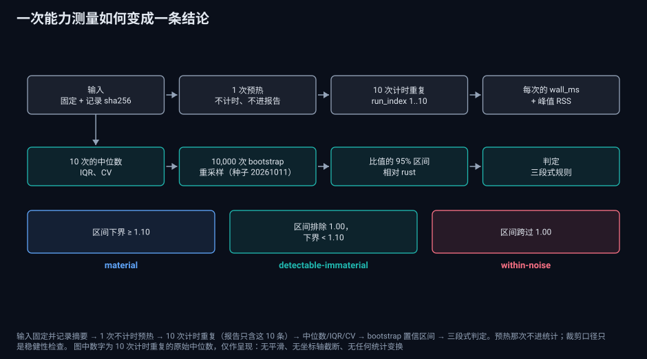

图：测量的完整链路——固定并哈希输入 → 1 次不计时预热 → 10 次计时重复 → 中位数/IQR/CV →
bootstrap 置信区间 → 三段式判定。**预热那次不进报告**，裁剪口径只是稳健性检查。

## 7. 环境披露

| 项 | 值 |
| --- | --- |
| 操作系统 | CachyOS（Arch 系），Linux 原生文件系统（非 drvfs 挂载） |
| CPU | Intel Pentium Gold G7400，2 核 / 4 线程 |
| 内存 | 15 GiB |
| GPU | 本基准**不使用 GPU**（另有一个独立 GPU 实验载体，不在本文范围） |
| Rust | rustc / cargo 1.99.0 |
| Python | CPython 3.14.7；numpy 2.5.4、Biopython 1.88、pytrf |
| R | 4.6.1；Bioconductor 3.23、Biostrings 2.80.2、jsonlite 2.0.0、digest 0.6.39 |
| CPUPower 调节器 | `powersave`（全程不变） |
| 存储 | 根文件系统 btrfs / 512 GB NVMe；**`/tmp` 是 tmpfs（7.7 GB），所有基准输入都在 RAM 上** → 测量里没有磁盘延迟项（另有 2 块机械盘存在，与本轮无关） |
| 计时 | GNU time 高精度模式 |
| 引擎版本 | v1.1.3 |

> 这是一台**低端机**：2 核 4 线程、无睿频余量、`powersave`。它的意义不是"代表服务器"，
> 而是一个**保守下限**：在更快的机器上，解释器启动与大块内存分配等常数项会被摊薄，
> 比值**可能因此变大或变小**，所以本文的所有比值都只按本机口径声明。

## 8. 结果

### 8.1 三端中位数与判定（N=10）

完整统计量见附表 S1（§13 列出全部附表与附图）。
摘录：

| 能力 | rust | python | r | python 判定 | r 判定 |
| --- | --- | --- | --- | --- | --- |
| `sequence.stats.v1` | 810 ms | 825 ms | 1 815 ms | 1.02× [1.01, 1.11] **可分辨，非实质** | 2.24× [2.23, 2.30] material |
| `expression.pca.v1` | 20 ms | 4 010 ms | 2 770 ms | 200× [133, 208] material | 138× [92.3, 140] material |
| `set.venn.v1` | 10 ms | 180 ms | 11 075 ms | 18.0× [18.0, 19.0] material | 1108× [1090, 1128] material |
| `enrichment.overrepresentation.v1` | 30 ms | 230 ms | 4 480 ms | 7.67× [7.33, 7.67] material | 149× [149, 157] material |
| `structure.pdb.summary.v1` | 30 ms | 780 ms | 20 680 ms | 26.0× [26.0, 30.0] material | 689× [683, 692] material |
| `variant.stats.v1` | 80 ms | 760 ms | 13 500 ms | 9.50× [9.50, 9.56] material | 169× [164, 174] material |
| `fastq.qc.v1` | 1 570 ms | 49 345 ms | 702 190 ms | 31.4× [31.1, 31.8] material | 447× [444, 447] material |
| `sequence.ssr.v1` | 1 600 ms | 2 280 ms | 2 211 405 ms | 1.43× [1.33, 1.45] material | 1382× [1290, 1391] material |

（本轮另有一次 N=3 窗口的同类测量，结论一致；见 §9 与台账 `docs/engine-evals/local-nas-g7400-window-2026-10-04.md`。）

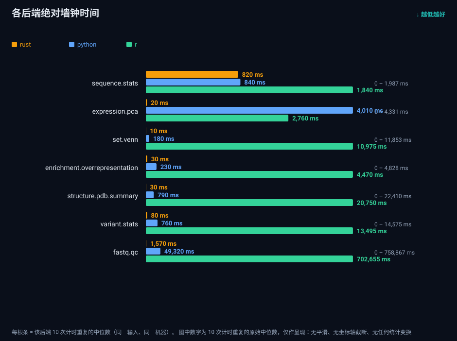

图：各后端的绝对中位数墙钟时间（线性刻度）。同一输入、同一机器、每后端 10 次计时重复。

### 8.2 内存（峰值 RSS，median-of-10）

| 能力 | rust | python | r |
| --- | --- | --- | --- |
| `sequence.stats.v1` | 5.9 MB | 69.6 MB (11.8×) | 321.1 MB (54.5×) |
| `expression.pca.v1` | 8.5 MB | 53.4 MB (6.3×) | 81.9 MB (9.6×) |
| `set.venn.v1` | 8.3 MB | 47.3 MB (5.7×) | 124.7 MB (15.1×) |
| `enrichment.overrepresentation.v1` | 15.0 MB | 61.0 MB (4.1×) | 145.4 MB (9.7×) |
| `structure.pdb.summary.v1` | 28.4 MB | 66.3 MB (2.3×) | 162.8 MB (5.7×) |
| `variant.stats.v1` | 6.2 MB | 45.9 MB (7.4×) | 122.3 MB (19.8×) |
| `fastq.qc.v1` | 6.2 MB | 46.0 MB (7.4×) | 79.4 MB (12.8×) |
| `sequence.ssr.v1` | 21.0 MB | 150.7 MB (7.2×) | 667.5 MB (31.8×) |

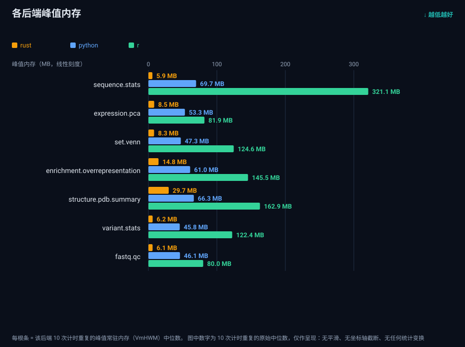

图：各后端峰值常驻内存（median-of-10，GNU time 的 VmHWM）。

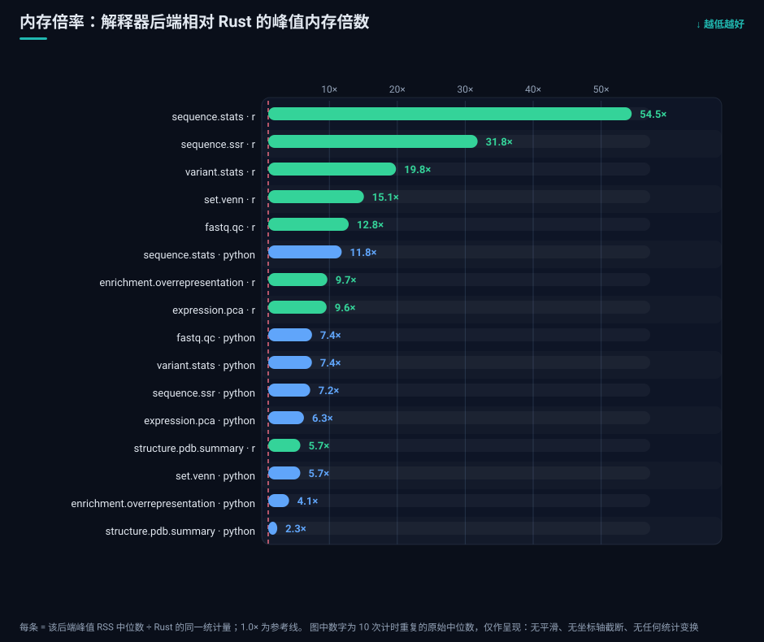

图：内存倍率——Python 腿 2.3×–11.8×，R 腿 5.7×–54.5×；唯一低于 2× 的行是 `structure.pdb.summary` 的 Python 腿（2.3×），
最高的是 `sequence.stats` 的 R 腿（54.5×）。

### 8.3 重复稳定性与比值区间

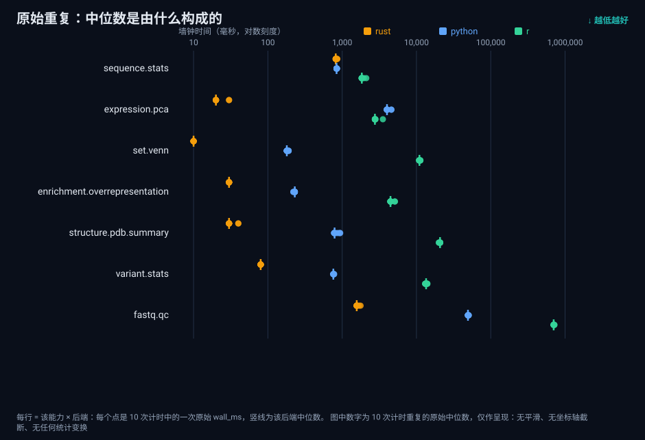

图：逐能力的 10 次原始 `wall_ms` 散布（竖线为各自中位数），用来检查"中位数不是被某一次运行拉出来的"。
多数能力的中位数在 10 次间落在 ±1 IQR 内；`sequence.stats` 的 rust 档位粒度是 10 ms
（`time` 的采样分辨），因此其 CV（1.95%）主要是**量化噪声**而不是真实抖动——这点限制了
小绝对值的分辨力，也是我们把实质性下限放在 1.10 而不是 1.01 的原因之一。

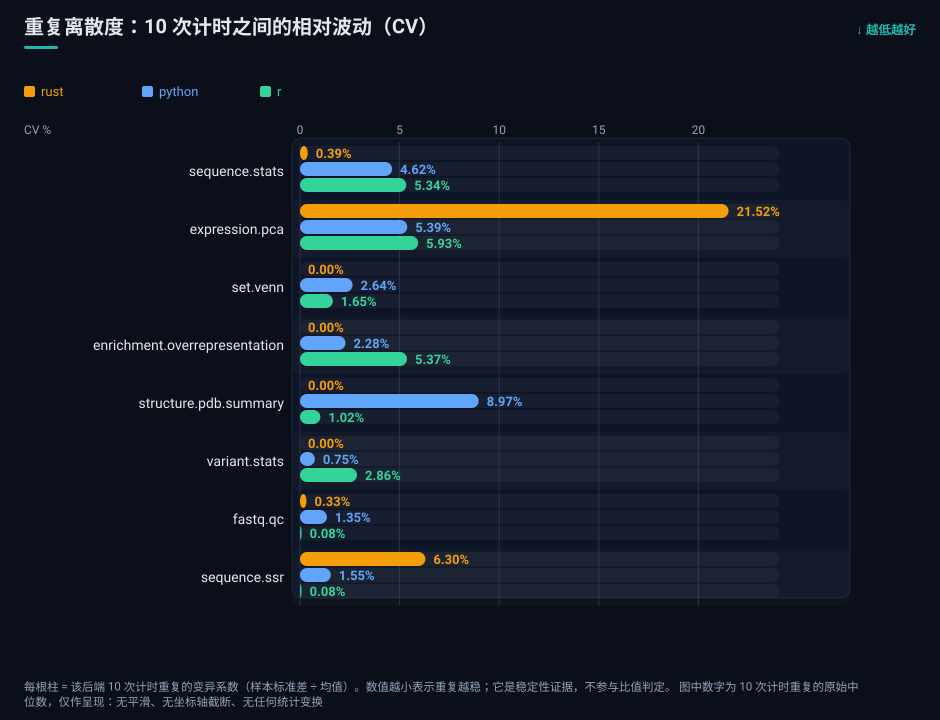

图：重复离散度——Rust 腿有 4 项在 10 次之间逐位相同（CV 0.00%），最高 21.52%（`expression.pca`，中位数仅 20 ms，
量化步长在其中的占比最大）；Python 腿 0.75%–8.97%，R 腿 0.08%–5.93%。离散度是稳定性证据，不参与比值判定。

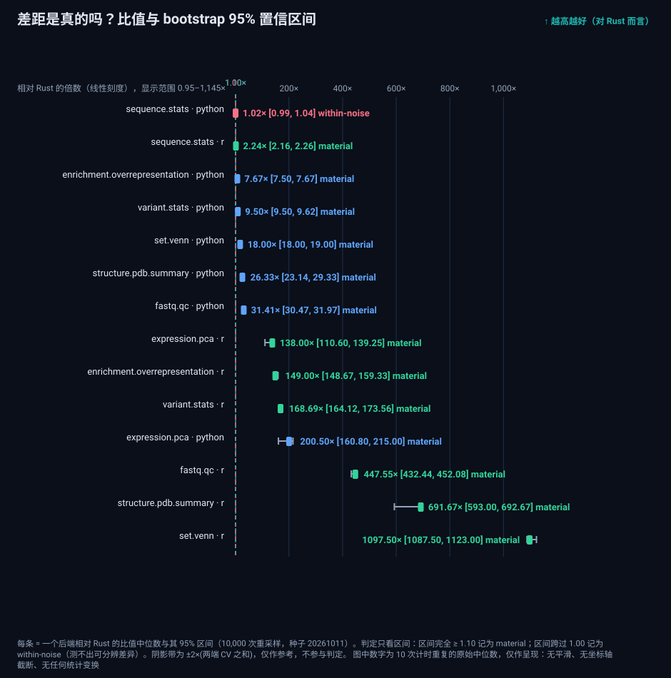

图：每对后端的比值与 95% CI；虚线为 1.00（无差异）与 1.10（实质性下限），标注给出判定。

### 8.4 裁剪稳健性

三种口径（全 10 / 去首 / 中间 8）的**判定完全一致（16 行 0 变化）**；中位数会按 10 ms 计时步长浮动
（14/24 行变化，明细见附表 S2）；详见
附表 S2 与附表 S3。
换言之：**没有哪一条结论是靠"保留某一次运行"得来的。**

### 8.5 记录粒度实验：一个被推翻的假设

**原假设**：`sequence.stats` 在百万级碱基上与 Python 只差 2%，是因为"每条记录才穿一次语言边界"；
那么记录越多，差距应越明显。

**实验**：同一约 100 Mb 的总量，三种记录形态，各 N=10。

| 输入形态 | rust | python | r |
| --- | --- | --- | --- |
| 1 × 100 Mb（1 条记录） | 810 ms | 850 ms | 1 820 ms |
| 20 × 5 Mb | 810 ms | 835 ms | 1 820 ms |
| 100 000 × 1 kb | 820 ms | 860 ms | 1 930 ms |

**结论：假设被推翻。** 记录数从 1 增到 10 万，rust 只多 10 ms、python 只多 10 ms
（比值 1.037 → 1.036）。在 ~100 MB 量级上，两侧都被 **I/O 与大块内存分配**主导：
每碱基的活由 C 原语（`str.count`/`str.upper` 一类）承担，而每行的读取与建串两侧都要付。

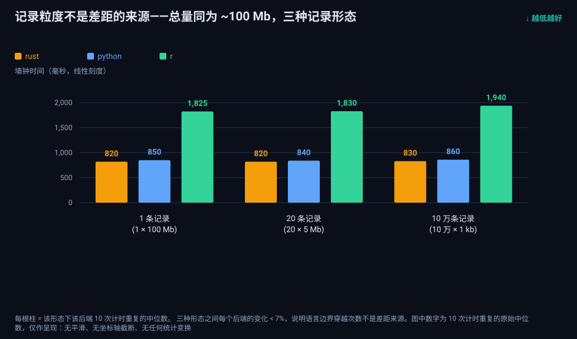

图：记录形态实验——总量不变，记录数从 1 到 10 万，三条线几乎水平，这就是原假设被推翻的直接证据。

更正后的解释（也是本文的分层依据）：真正的分界线不是"记录数"，而是**"每个输入元素是否需要
解释器参与"**。逐碱基逻辑落在 C 里的能力（`sequence.stats`）≈1×；逐项/逐记录逻辑落在解释器里
的能力（`set.venn`/`pdb`/`variant`/`enrichment`/`fastq.qc`）从 7.67×（`enrichment` 的 Python 腿）
一路到 1108×（`set.venn` 的 R 腿）。
小输入上出现的 ~20× 则是**解释器启动约 170 ms** 落在 10 ms 级工作负载上的占比，不代表吞吐能力。

**我们原本预期什么、实测推翻了什么。** 最初的直觉是"数据在语言边界来回搬运"会带来可观代价——
Python 读 FASTA、把序列交给统计、再把结果传回来，多几次搬运就该慢一截。实测没有：
Python 侧的热点循环**并不在解释器里**，而在 CPython 的 C 原语里（`str.count`/`str.upper` 这类），
Biopython 的解析循环虽然逐行穿过解释器，但每行的工作量很小，而两侧都必须付的
大块内存分配与文件读取把这点差异吃掉了。所以 `sequence.stats` 的 1.02× 不是"Rust 没有优势"，
而是**这一项上两者的关键路径都落在原生代码里**——这也正是分层结论的第一层。
反过来说，一旦每元素的工作必须由解释器执行（逐碱基的 `fastq.qc`、逐项的 `set.venn`），
同一条边界就变成 31.4×–1382× 的代价（§8.6）。

### 8.6 分层速览

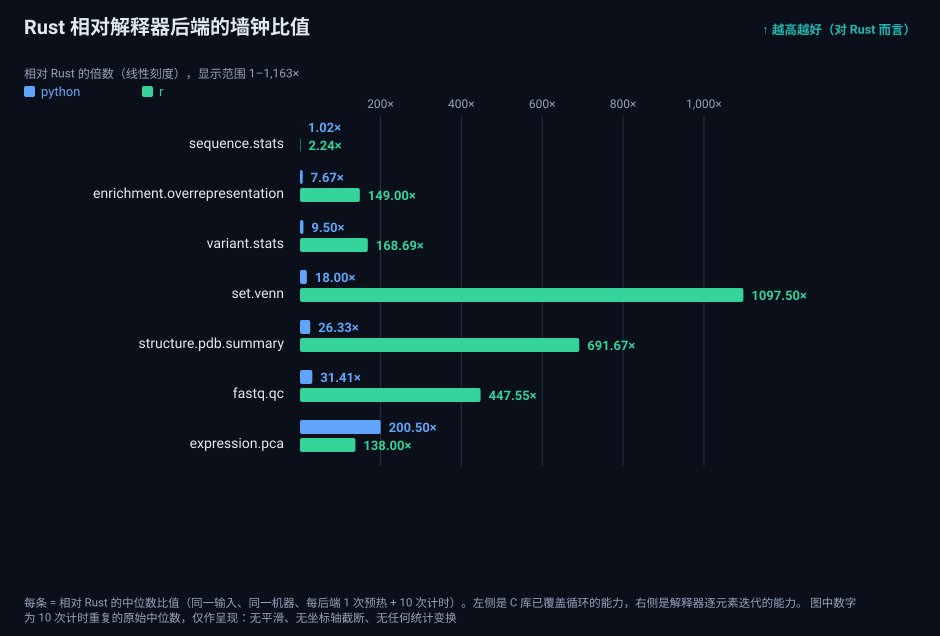

图：分层速览——比值按层次排序，左侧是 C 库已覆盖循环的能力，右侧是解释器逐元素迭代的能力。

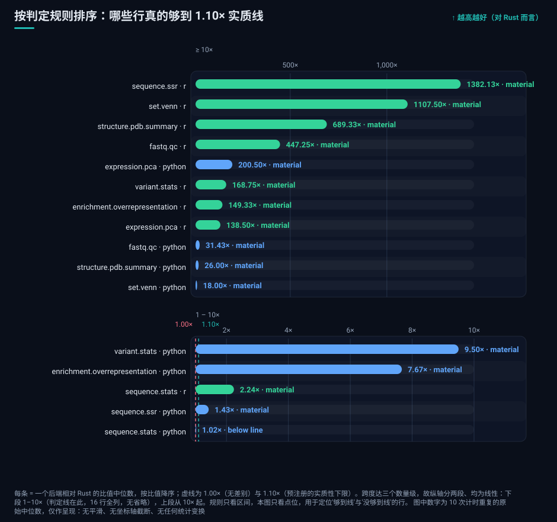

图：判定视角的阶梯——16 行中 15 行 ≥ 1.10×；唯一例外是 `sequence.stats` 的 Python 腿（1.02×）。
跨度达三个数量级，故纵轴分两段（1–10× 与 ≥10×）、均为线性，判定线落在下段。

| 层次 | 能力 | python | r |
| --- | --- | --- | --- |
| C 原语可覆盖的线性扫描 | `sequence.stats` | 1.02×（可分辨，非实质） | 2.24× |
| 逐位置扫描（Python 侧为 pytrf，C 扩展） | `sequence.ssr` | 1.43× | 1382× |
| 逐碱基解释器循环 | `fastq.qc` | 31.4× | 447× |
| 逐项解释器循环（内存内小对象） | `set.venn` | 18.0× | 1108× |
| 逐基因/逐变异解释器循环 | `enrichment`、`variant` | 7.67× / 9.50× | 149× / 169× |
| 逐原子解释器循环 | `structure.pdb.summary` | 26.0× | 689× |
| 三臂同算法手写幂迭代（无线性代数库） | `expression.pca` | 200× | 138× |

注意 `expression.pca` 一行：**三个臂都是同一套手写幂迭代**（500 次迭代 + Gram-Schmidt 去相关；
`prcomp`/`scikit-learn` 被刻意排除，理由见 §4），所以这一行的差异**不来自库**，而全部来自运行时边界——
同样的标量循环在解释器里跑（Python/R）还是在原生代码里跑（Rust）。Python 反而比 R 慢（200× vs 138×），
差别在解释器自身的循环开销与纯 Python 的逐行 `csv` 解析，而不是"哪个数值库更好"。
**修正 2026-10-12**：初版此处误写为"两侧走的都是向量化库（numpy vs `prcomp`）"，与实际代码不符。

### 8.7 正确性证据（跨后端一致性）

每一份 benchmark 报告都带三端一致性判定：**全部 8 项在 1e-6 相对容差内 `consistent`**，
精度档 `high`。此外做了跨机确定性核对：同一生成器产物在 NAS 与另一台机器上
sha256 逐字节一致（如 `ref.fa`、`cell.tsv`、`cell.json`）。
表：附表 S5。

**与早期报告记录的精确度量对比**（两个窗口各自记录了什么，如实并列，不混排）：

| 校验项 | 早期窗口 `bench-20260913-001` | 本轮（N=10） |
| --- | --- | --- |
| 后端一致性判定 | Consistent（4 项） | `consistent`（8/8 项） |
| 一致性容差 | 1e-6 相对 | 1e-6 相对（同默认） |
| PDB 逐字段偏差 | **0.0**（完全相同） | `findings` 为空（无差异字段路径） |
| PCA / Venn 最大相对误差 | **≤ 2.26e-11** | 本轮改以判定口径记录：`consistent`，无差异字段 |
| 精度档 | `high` | `high` |
| 跨机确定性 | 未记录 | 是：`ref.fa`/`cell.tsv`/`cell.json` sha256 跨机一致 |

诚实说明：早期窗口额外记录了**数值级**的 parity 误差（如 2.26e-11），本轮记录的是
**判定级**证据（是否在 1e-6 内、有无差异字段）。两者不能互相替代，所以本表把两套口径
并列展示，而不是把"0.0 / 2.26e-11"挪到本轮名下。


### 8.8 条件对照：CI 抢核前后（同一协议、同一机器）

本机同时承载本地 CI runner。首次那批测量期间有两次作业落在 `fastq.qc` 的 R 腿窗口内；停用作业后按同一
协议**整窗重跑**（`window-log.txt` 逐阶段记录 CI 作业计数为 0，`jobs=0`）。两批逐能力、逐后端对照
（`condition-comparison.tsv`，30 行）：

| 对照行 | 有并发批 | 干净批 | Δ | 噪声带 |
| --- | --- | --- | --- | --- |
| `sequence.stats` / python | 840 ms | 825 ms | −1.79% | ±10.47% |
| `sequence.stats` / r | 1 840 ms | 1 815 ms | −1.36% | ±20.28% |
| `sequence.stats` / rust | 820 ms | 810 ms | −1.22% | ±4.67% |
| `fastq.qc` / r | 702 655 ms | 702 190 ms | −0.07% | ±1.92% |

- **30 行全部落在噪声带内，0 行超噪**（噪声带取 2×(CV_有并发 + CV_干净)，逐行计算）；最大位移仅 −1.79%。
- 因此**没有任何行被排除**：本文采用重跑批数字（归档 `bench-20261011-001`），并同时公开两批原始报告
  （`contended-window/` 与归档根目录）供任何人复核。

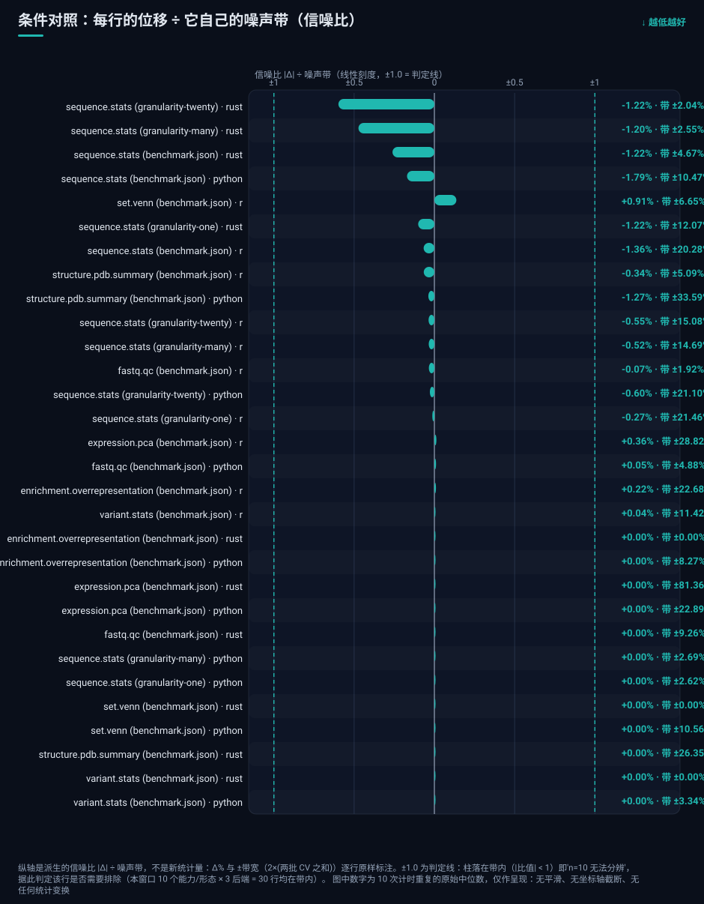

图：条件对照的信噪比视图——30 行的 |Δ| ÷ 噪声带全部小于 1（最大 0.26，`sequence.stats` 的 Rust 腿：−1.22% 对 ±4.67%），
因此 0 行超噪、无需排除任何行；原始 Δ% 与 ±带宽逐行标注。

## 9. 与九月窗口的对比

同能力、同命令、不同输入规模与不同窗口的对照（附表 S4，由 2026-09-13 归档生成）：

| 能力 | 九月窗口（N=5，小夹具） | 本轮（N=10，大输入） | 排序是否一致 |
| --- | --- | --- | --- |
| `sequence.stats` | 40 / 330 / 2110 ms | 810 / 825 / 1 815 ms | 一致（rust ≤ py < r） |
| `expression.pca` | 40 / 300 / 460 ms | 20 / 4 010 / 2 770 ms | 一致 |
| `set.venn` | 40 / 310 / 400 ms | 10 / 180 / 11 075 ms | r 的位置随规模剧变 |
| `structure.pdb.summary` | 40 / 320 / 410 ms | 30 / 780 / 20 680 ms | 一致（量级随规模展开） |

**为什么只有四行**：本表只放"两个窗口都有入库三端行"的能力（数据取自
`../statistics-comparison.tsv`）。`enrichment.overrepresentation`、`variant.stats`、`fastq.qc`、
`sequence.ssr` 在九月归档里**没有三端行**，因此不列——把不同口径的数字并排放进来才是失实。
其中 `variant.stats` 目前唯一的早期数字是一次 Windows 端到端单重复（rust 42 ms / python 301 ms，
2026-09-19，**无 r 行**），与本轮 200k 变异的大输入不可比，仅作记录：见[`仓库基准记录`](https://github.com/Linxira-OS/linxira-bio-sdk/blob/main/benchmark-results/RECORDS.md)的 2026-09-19 条目。

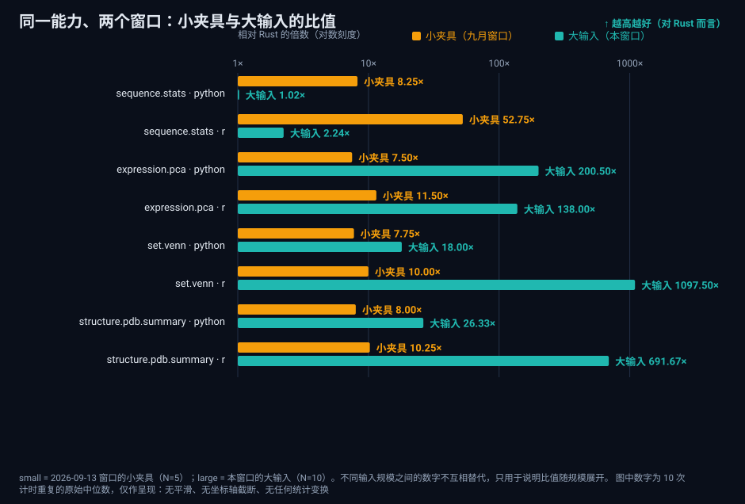

图：同一能力在两个窗口里的比值（`small` = 九月小夹具，`large` = 本轮大输入）。
小夹具上三端被启动/常数项拖平，比值反而更大；大输入上才显出真实吞吐。

读法：**小夹具上三端都被启动/常数项拖平**（几十到几百毫秒），量级差距要在大输入上才展开；
而 `set.venn` 的 R 腿在小夹具上看着"还行"（400 ms），到大输入直接变成 11 075 ms——
这与 §8.5 的分层解释一致。

同能力的跨窗口**绝对**数字（相同输入时）中位差 <3%，说明本机测量本身是可复现的；
跨窗口数字不能直接比较的是**输入规模不同**的那些行（上表已标注）。

## 10. 工程发现：R 腿"真的跑起来"之后

三端测量真正的收获不是分数，而是**把人逼到必须真的执行**。R 后端此前从未在 CI 中运行过测试，
本次补上执行路径后一次性暴露 6 个缺陷，全部已修合并：

| # | 症状 | 根因 |
| --- | --- | --- |
| 1 | SSR 能力直接报错 | Biostrings 只对 `XStringSet` 定义 `width()`，裸 `XString` 无方法 |
| 2 | 测试字面量与断言不符 | 测试里那个"22 bp"字面量实际是 23 个字符 |
| 3 | SSR 恒返回 0 条 | `start(...)` 未加命名空间前缀，命中了 `stats::start`（时间序列） |
| 4 | 上述问题长期潜伏 | **CI 从未运行 benchmark 两个包的测试**（无任何 step） |
| 5 | 无 SSR 的输入被 worker 拒绝 | 空 `list()` 被序列化成 `[]`，而契约要求 map（`{}`） |
| 6 | 20k 项输入的 `intersections` 数量错误 | 按 item 逐条生成，未按 occupancy mask 分组 |

另外顺带抓到一个**产品级**缺陷：`looks_like_sam` 仅凭"≥11 列 + 若干整数列"就把**宽计数矩阵**
判成 SAM（实测边界：10 列 → tsv，11 列 → sam），任何 ≥11 个样本的表达矩阵都会被 worker 拒绝。
已改为要求 SAM 的结构证据（FLAG 上界、RNAME 非纯数字、CIGAR 语法、SEQ 碱基字母）并加回归测试。

教训一句话：**测试存在但不在 CI 执行 = 不存在。**

## 11. 局限与诚实边界

- **这台机器只测到了单核（重要）。** 三端在本窗口的关键路径都是**单线程**的：引擎当前没有使用
  `rayon`/线程池（核查方式见 §13），而 CPython 的 GIL 会把纯计算的
  Python 循环钉在一个核上、R 的解释器同样是单线程（只有 BLAS 之类本身带线程的库例外）。
  这台 2 核/4 线程的低端机因此**完全没有体现 Rust 在并行上的语言级优势**——Rust 能安全地跨核扩展，
  而 Python/R 在这一层基本做不到；我们**不把没测到的东西算成优势**。反过来说，如果 Python 腿的
  向量化路径（numpy/BLAS）在本机用了多线程，那么"Rust 用更少的核还快 200×"只能说明它的
  **单核效率**更值得被强调，而不是相反。多核扩展性需要另一次在众核机器上的测量，属于后续工作。
- **整栈比较**，不是语言对语言：三个对照臂是**同一算法**的三种语言实现（parity arm），只让运行时不同；
  解析层用 Biopython/Biostrings，SSR 的 Python 臂用 C 扩展 `pytrf`。换用各语言的标准工具
  （`fastp`/`seqkit`/`pyfastx`/`scikit-learn`/`prcomp`）会显著改变比值——那是另一类臂（tool arm），本轮未测。
- **单机、单输入规模、`powersave`**：这台机器是保守下限；不同 CPU/内存带宽上的比值可能不同。
- **后端串行测量**的已知偏差：跨后端存在频点/热漂移（本机 `powersave` 已尽量压低），
  我们披露每后端 10 次原始墙钟而不只给汇总，读者可自行判断。
- **计时分辨力**：`time` 在 10 ms 档位上有量化，小绝对值（如 rust 10–30 ms）的 CV 因此偏高，
  这也是实质性下限取 1.10 的原因之一。
- **本轮未用第三方基准套件**；GIAB + hap.py（正确性）与公开托管基准平台（机器谱系锚定）
  为**计划中**，未执行前不作为证据。
- 我们**不**声明"Rust 普遍更快"。本文能支持的只有逐能力的、带区间的、限定在本机本输入下的结论。

## 12. 复现

本轮窗口的**整链**（暂存报告 → 输入摘要 → summary → 统计表 → 图 → 图校验）是一键脚本，
随仓库发布：[`archive.sh`](https://github.com/Linxira-OS/linxira-bio-sdk/blob/main/scripts/benchmark/windows/2026-10-11/archive.sh)（同目录另有窗口 descriptor 与逐步脚本）。
脚本与归档位于 <https://github.com/Linxira-OS/linxira-bio-sdk>，下列命令均以仓库根目录为工作目录：

```bash
# 1) 生成输入（固定种子，只写 /tmp）
python scripts/benchmark/inputs/generate-inputs.py --out /tmp/lxn10   # 见台账内的种子说明

# 2) 逐能力重复测量（每后端 1 次预热 + 10 次计时）
linxira-bio benchmark run <capability> --input <file> --backends rust,python,r --repeat 10 \
  --report /tmp/lxn10/out-<capability>/report.json

# 3) 汇总为归档（校验 schema）与统计表
python scripts/benchmark/analysis/summarize-reports.py --reports-dir /tmp/lxn10 --descriptor descriptor.json \
  --output-dir benchmark-results/2026-10-11
python scripts/benchmark/analysis/statistics-tables.py --summary benchmark-results/2026-10-11/summary.json \
  --reports benchmark-results/2026-10-11 --output-dir benchmark-results/2026-10-11

# 4) 出图（自包含 SVG）
python scripts/benchmark/figures/render-svgs.py --summary benchmark-results/2026-10-11/summary.json \
  --reports benchmark-results/2026-10-11 --output benchmark-results/2026-10-11/blog-mirror/figures
```

## 13. 数据与代码可用性

- 归档：`benchmark-results/2026-10-11/`（`summary.json` / `summary.md` / 每能力报告 / 统计 TSV）。
- 原始逐次墙钟：各能力报告的 `backends[].runs[]`（每后端 10 条，含 `wall_ms`、`peak_rss_mb`、`ok`）。
- 输入哈希：见 `summary.json` 的 `data_sources[]`（本窗口生成的输入在归档时记录）。
- 图表：`benchmark-results/2026-10-11/blog-mirror/figures/zh/` 与 `figures/en/`（各 12 张自包含 SVG，
  无脚本、无外链；中英两套由同一份数据一次生成）。

**附表与附图索引（正文按编号引用）**

| 编号 | 文件 | 内容 |
| --- | --- | --- |
| 附表 S1 | [`statistics.tsv`](https://github.com/Linxira-OS/linxira-bio-sdk/blob/main/benchmark-results/2026-10-11/statistics.tsv) | 每能力 × 后端的 N、中位数、IQR、CV、min/max、峰值 RSS、比值、95% CI、判定 |
| 附表 S2 | [`statistics-trimmed-medians.tsv`](https://github.com/Linxira-OS/linxira-bio-sdk/blob/main/benchmark-results/2026-10-11/statistics-trimmed-medians.tsv) | 三种裁剪口径下的中位数与 CV |
| 附表 S3 | [`statistics-trimmed-verdicts.tsv`](https://github.com/Linxira-OS/linxira-bio-sdk/blob/main/benchmark-results/2026-10-11/statistics-trimmed-verdicts.tsv) | 三种裁剪口径下的比值、CI 与判定 |
| 附表 S4 | [`statistics-comparison.tsv`](https://github.com/Linxira-OS/linxira-bio-sdk/blob/main/benchmark-results/2026-10-11/statistics-comparison.tsv) | 与 2026-09-13 归档的跨窗口对照 |
| 附表 S5 | [`statistics-consistency.tsv`](https://github.com/Linxira-OS/linxira-bio-sdk/blob/main/benchmark-results/2026-10-11/statistics-consistency.tsv) | 跨后端一致性、容差、精度档 |
| 附图 F1–F12 | [`blog-mirror/figures/<lang>/`](https://github.com/Linxira-OS/linxira-bio-sdk/blob/main/benchmark-results/2026-10-11/blog-mirror/figures) | 方法与判定、绝对时间、内存（绝对值与倍率）、比值 CI、重复稳定性、离散度（CV）、粒度、分层速览、判定阶梯、双窗口对比、条件对照信噪比 |

**第三方可核查方式（全部在仓库内）**

| 你想核查什么 | 怎么做 |
| --- | --- |
| 输入是否可复现 | 运行 [`generate-inputs.py`](https://github.com/Linxira-OS/linxira-bio-sdk/blob/main/scripts/benchmark/inputs/generate-inputs.py) 重新生成，与归档的 `inputs.sha256` 逐字节比对 |
| 统计量是否由图与表一致 | 运行 [`verify-figures.py`](https://github.com/Linxira-OS/linxira-bio-sdk/blob/main/scripts/benchmark/figures/verify-figures.py)：它把图上每个数字（含原始重复图的 210 个点）反解回报告里的原始 `wall_ms`，不一致即非零退出 |
| 图是否经过平滑/截断加工 | 每张图注都印有"无平滑、无坐标轴截断、无统计变换"的声明；校验脚本同时检查该声明存在、且图注不超出画布 |
| 引擎当前是否用到并行 | `grep -rn "rayon\|thread::spawn\|par_iter" engine/crates/` 无命中即为无并行设施（本窗口的核查结果） |
| 重跑与条件对照是否可查 | 归档内的 `condition-comparison.tsv`（30 行逐能力/后端）与 `window-log.txt`（逐阶段 CI 作业计数与 loadavg） |
| 整窗如何一键复现 | [`archive.sh`](https://github.com/Linxira-OS/linxira-bio-sdk/blob/main/scripts/benchmark/windows/2026-10-11/archive.sh)（暂存报告 → 输入摘要 → 归档 → 统计表 → 双语图 → 图校验） |

## 14. 讨论与展望

### 14.1 讨论：分层现象说明了什么

把八项能力放在同一张纸上，能看到一个相当稳定的模式：**Rust 的收益与该能力"每元素的工作落在哪一层"几乎一一对应**。
当关键路径已经在 C 库或向量化数值库中完成时（`sequence.stats` 的逐碱基计数、`expression.pca` 的矩阵分解），
三端的差距会收缩到 1.0×–2.24×，其中 `sequence.stats` 的 Python 腿只差 1.02×（CI 下界 1.01，够不到 1.10 的实质阈值）；
而当每个元素都必须经过解释器时（逐记录、逐项、逐原子、逐碱基），差距按 7.7× → 26× → 31× 展开，
R 腿进一步到 149×–1382×。这不是"语言排名"，而是**工作负载形状的函数**：它预测的是
"这段代码把时间花在解释器里还是花在原生代码里"，而不是"这个语言好不好"。

对使用者的直接含义有三条：**其一**，如果你的瓶颈是线性扫描大文件，三端的差别可能真的可以忽略，
此时更该关心内存占用与启动开销（本轮 Rust 在中位内存上稳定占优，两个解释器后端分别高出 2.3×–11.8× 与 5.7×–54.5×）；
**其二**，如果瓶颈是"每元素都要做一点判断"的循环（质控、集合运算、注释解析、变异遍历），
差距会直接变成一到三个数量级；**其三**，`expression.pca` 这一行常被误读成"库的质量掩盖了语言差异"，必须纠正：三个臂用的是
**同一套手写幂迭代**（刻意不用 `prcomp`/`scikit-learn`，以保住逐字节对照），所以 200× 与 138×
量的是"解释器标量循环 vs 原生标量循环"。真正的"库质量掩盖语言差异"证据在同轮另一行：
`sequence.ssr` 的 Python 臂换成 C 扩展 `pytrf` 后，差距从 31× 级塌到 **1.43×**。

### 14.2 展望：多核、GPU，与虚拟细胞

本轮最重要的结论之一是**范围**结论：我们只测到单核，而 Rust 在并行上的语言级优势恰恰尚未登场。
把没测到的当作优势来写是不诚实的，所以下一步的计划在这里明确。

**多核是第一优先。** 当前引擎的 CPU 密集路径没有使用任何并行设施，压缩输入的解压与计算也没有重叠——
这意味着在 TB 级 gzip 数据上，它与原生 Python/R 的差距会被 I/O 与解压吃掉（Python 的 `gzip` 同样是单线程，
这一项目前无法拉开）。已确定的落地方向是：并行解压（BGZF 分块读、普通 gzip 走 SIMD 解压库）、
解压与计算流水线重叠、以 Rayon 承担多核计算、以 Tokio 编排海量文件与进程的 IO 并发。
**本轮的 1.02×–1382× 是单核数字**；并行落地后，超大序列比对与多轨迹模拟的差距应由核数继续放大。
届时的测量会在同一协议之上扩展：加入**核数—加速比曲线**（含并行效率与拐点），
并把每个测点的线程数固定在报告里，否则读者无法区分收益来自算法还是来自核数。

**各家在"Rust 写加速器"上的官方进度并不一样（本文按 2026-10-12 复核，出处见 §17）。** 先分清两件常被
混为一谈的事：**"Rust 能调用 GPU"与"Rust 能编写内核"**。四家厂商在这两件事上位置完全不同。

- **NVIDIA**：唯一**两层都官方**的一家——运行时 crate（`cuda-bindings`/`cuda-core`/`cuda-async`）加上
  两个官方内核模型：`cuda-oxide`（SIMT；自研 rustc codegen 后端 → PTX；固定 nightly）与 `cutile-rs`
  （Tile DSL；stable Rust 1.89+；JIT → Tile IR → cubin）。官方自述仍是早期研究项目，允许 breakage。
- **Intel**：host 侧三条（`intel/openvino-rs` 推理绑定，覆盖 CPU/GPU/NPU；`oneapi-src/oneapi-rs` 的
  `sycl-rs`；`intel/ittapi` 插桩），但**内核不能写 Rust**——`sycl-rs` 的内核是**内嵌的 C++ SYCL
  源码字符串**，交给 DPC++ 编译（官方示例 `IOTA_SRC` + `create_kernel_bundle_from_source`）。
  `sycl-rs` 自述 experimental、未发布 0.1.0、仅 Linux + oneAPI 2026.1 测试配置。
- **AMD**：**主机侧官方已经大量用 Rust**——ROCm 组织下有 5 个 Rust 仓库（Slurm CLI/REST 兼容的调度器
  `spur` 132 星、面向用户的 `rocm-cli`（官方自述 Tech Preview）、`spur-cloud`、`axis`、`cm`），且
  `amdsmi` 自带官方 `rust-interface/` crate；但**没有官方的内核编写路径**（HIP 的 Rust 绑定均属社区）。
  要在 AMD 上写 Rust 内核，当前现实路径是第三方 `CubeCL`（Rust `#[cube]` → LLVM → PTX/AMDGPU，alpha）
  或 `wgpu`/SPIR-V；**XDNA NPU 各层都没有 Rust**（官方为 C++/Python）。
- **摩尔线程**：**官方维护两个 Rust fork**——`cudarc-musa`（feature `musa-50200` = MUSA 5.2 Driver ABI，
  示例 `musa-driver-vector-add`）与 `sppark-musa`（crate `sppark` 的 `musa` feature，`MCC`/`MUSA_ARCH`
  选择编译器与目标，另带 Go 桥）；但**内核体仍是 C++/MUSA**（由 `mcc` 编译），Rust 在 host 层。

我们自己的执行记录同样要分清：**已经跑通的是"一份 C/C++ 内核源码、两家原生工具链"**——同一份内核套件
（copy/triad/直方图/Pearson）分别用 `nvcc`（RTX 4080S，sm_89）与 `mcc`（MTT S4000）编译，
median-of-3、逐项正确性门全过，两卡在各内核上的比值可复算（§17 出处）。**Rust 内核那一步我们尚未跑通**：
`cutile-rs` 当时不在 crates.io、依赖链与驱动门槛使其未进入执行；摩尔线程的 `cudarc-musa` 官方 Rust
调用层**已经存在、但我们从未实测**（我们的 `gpu-musa` 后端目前仍是 stub）。所以"一份 Rust 源码、
两家厂商"是**待验证路线**，已完成的结论是**单源内核的可移植性**——剩下的是工具链成熟度，不是架构问题。

**虚拟细胞为什么两者都需要。** 我们实现的机制型细胞模拟（Gillespie 精确法、转录爆发、Monod 生长、
二项分裂）当前同样是单线程的。这类模拟的并行轴天然存在：不同轨迹、不同参数点、不同细胞彼此独立，
属于典型的"令人尴尬的并行"；一旦要做参数扫描或群体级模拟，核数直接决定可研究的规模。
再往上，把组学层面的计算接入（这正是"AI 虚拟细胞"方向真正吃算力的地方）会让 GPU 成为必需品，
而 Rust 现在在两家厂商的官方 GPU 路线上都有了入口。

**这些数字的定位。** 本窗口的单核数字将成为并行版本的对照基线：同一台机器、同一批输入、同一套协议，
才能把"并行带来的收益"与"语言/实现差异"分开报告。并行实现将按版本共存的方式推进并重新走完整验收
（契约、夹具、技能文档、双语文档），**本文不承诺时间表**。

## 15. 常见问题与回答

**Q1：Rust 的领先是不是只因为对手是解释器？**
不完全是，而且这个说法本身被数据反驳：`sequence.stats` 只差 1.02×（CI [1.01, 1.11] 不含 1.00，可分辨但低于 1.10 的实质阈值），
因为该能力的逐碱基逻辑在 C 原语里完成；解释器代价只出现在"每个元素都必须过解释器"的能力上。
换句话说，优势来自工作负载形状，而不是来自"对手是解释器"这一事实本身。

**Q2：对照臂是否写得不够优化，从而放大了差距？**
先纠正一个容易误解的说法：对照臂**不是**"各语言的惯用库写法"，而是**同一算法**在三种语言下的实现
（parity arm），刻意排除会替换算法的生态库（§4）。所以它们既没有"故意写慢"，也不是"Python 的最优解"：
它们量的是语言边界。若换成各语言的标准工具（`fastp`/`seqkit`/`pyfastx`/`scikit-learn`），比值会显著变化——
这正是 §16 尾声要做的事。我们也不主张"Python 慢"这一笼统说法。

**Q3：只测单核，是否等于没有体现 Rust 的真实优势？**
是，而且这一点已写入摘要与 §11：引擎当前不含任何并行设施，CPython 受 GIL 约束，R 的解释器也是单线程；
在 2 核/4 线程的机器上，**并行优势在物理上就不可能体现**。我们不把未测量项计为优势，多核列为后续第一优先。

**Q4：10 次重复是否足以支撑结论？**
判定规则在测量前固定（区间排除 1.00 才称可分辨；区间下界 ≥1.10 才称 material），三种裁剪口径结论一致，
每后端 10 条原始墙钟全部公开；而唯一不构成实质差距的那一项，我们就写"可分辨但不计为优势"。这本身就是统计纪律的证据。

**Q5：为什么只用一台机器、一种输入规模？**
单机单规模是本窗口刻意设定的范围；输入规模为 100–200 MB，远高于启动开销的量级。
跨机器的锚定（公开托管基准平台）与正确性真值（GIAB 与 hap.py）列为计划中，未执行前不作为证据。

**Q6：R 腿在 SSR 上每次约 37 分钟，是否刻意选择了最慢的库？**
该腿使用 Biostrings 的 `matchPattern`，是这一生态的标准做法，其代价随输入与模体空间增长；
我们如实给出绝对耗时（N=10 中位数 **2 211 405 ms**，约 36.9 min/次），并说明这是算法特性而非调参结果。
同一能力上 Python 侧用的是 **`pytrf`（C 扩展，不是纯 Python）**，所以 Python 腿只差 1.43×——
这恰好说明本文是"整栈比较"：与 C 扩展比差距小，与 R 的逐位置解释器循环比差距是三个数量级。

**Q7：内存对比是否公平？**
使用同一工具（GNU `/usr/bin/time -v` 的 VmHWM）、同一时刻定义、取 10 次中位数；
并明确披露常驻集大小不等于全部内存占用（共享库与映射文件的归属方式不同）。

**Q8：为什么没有使用第三方基准套件？**
本轮对照臂是第三方**库**实现，不是第三方基准套件，这两件事不能混为一谈；GIAB 与 hap.py（正确性真值）、
公开托管基准平台（机器谱系锚定）为计划中，未执行前不作为证据（§4、§11）。

**Q9：如何确认图上的数字与表格一致，而不是被"调"过的？**
图与表由同一脚本从同一份归档生成；复核脚本会把图上每个数字（含原始重复图的 210 个点）反解回归档中的数值，
不一致即报错；每张图注均印有"无平滑、无坐标轴截断、无统计变换"的声明，坐标轴一律线性且截断范围直接写在图上。
核查方式见 §13。

## 16. 尾声：明天的第二轮——把"同一算法"换成"各语言的标准做法"

写完这一轮，我们把自己的三个对照臂源码逐行重读了一遍，发现一件必须写在明处的事，它也决定了下一步。

**本届三个臂是"同一算法 × 三种语言"，不是"三种语言的惯用写法"。** 为了让变量收敛到运行时边界，
三个臂实现同一个算法（同一迭代式、同一 Gram-Schmidt 去相关顺序、同一收敛阈值），并刻意排除
会替换算法的生态库（`prcomp`、`scikit-learn`、`gseapy`、`clusterProfiler`、`bio3d`、`phyper`；理由见 §4）。
唯一放行的外部原生代码是解析层（Biopython/Biostrings）与一个 C 扩展臂（`sequence.ssr` 的 `pytrf`）。

由此可以说清本文数字的边界：它回答**"同一算法的关键路径落在解释器还是原生代码里"**，
而不是"Rust 对比最好的 Python 工具"。反证就在本文内部：`sequence.ssr` 的 Python 臂换成 C 扩展
`pytrf` 后，差距从 31× 级塌到 **1.43×**。

**明天（2026-10-13）我们会按更标准的代码再跑一轮，把"各语言/生态的标准做法"作为第二类臂（tool arm）**：
`expression.pca` 用 `scikit-learn` 与 `prcomp`，`sequence.stats` 用 `pyfastx`/`seqkit`，
`fastq.qc` 用 `fastp` 与 `pyfastx`，其余能力尽量换成生态公认实现，并**逐项标注算法是否等价**。

两类臂分开测量、分表呈现、**绝不混排**：

- **parity arm（本届）**：同一算法，测语言运行时边界；
- **tool arm（下一轮）**：各语言/生态的标准工具，测"用户真实会拿到什么"。

同一轮里我们还会补上**第三方锚点**（此前一直是"计划中、未执行"，这次明确排期）：
① 压缩对照用 `lzbench` 与 Squash（单线程参考 + 固定迭代语义）；
② 引用 PTS 的 `compress-gzip`/`compress-zstd`/`compress-7zip` profile（带 profile 版本与运行命令）
并把本轮结果上传 OpenBenchmarking 做**机器谱系锚定**（附 PTS 自身的可比性警告：同版本、同硬件、同日）；
③ 正确性真值用 GIAB HG002 + hap.py，**与速度声明分开陈述**。
注意 PTS 至今**没有 bgzip profile**，所以"第三方套件里已有的生信/压缩项"能对上的只有一部分——
对不上的部分我们只能如实说明，而不是拿别的负载冒充。

协议不变（固定输入与 sha256、1 次不计时预热 + N=10 计时、中位数 + bootstrap CI、两段式判定、
裁剪稳健性、条件对照），因此两轮数字可直接对照——但**两类臂之间不可混排比较**。
这是本轮最重要的一条自我更正：先把自己写的是什么弄清楚，再谈谁快。

**同一轮还要修三处"锁与环境不一致"**（重读代码时发现，属可复现性缺陷而非数字错误）：
① Python pack 的 `requirements.lock` 锁 `biopython==1.85`/`numpy==2.2.4`，而归档环境实测为
Biopython 1.88 / numpy 2.5.4 —— 锁没有约束住实际运行的环境，下一轮统一；
② `expression_pca_v1.py` 的 docstring 曾声称 `numpy.linalg` 参与运算（实际未用），已更正；
③ 对照臂在路线图里被写成"生态对标工具"，与实际的 parity 臂互斥，已改为两类臂通则（§7.1）。

## 17. 参考文献

1. NVIDIA. *CUDA Rust platform*（`cuda-oxide`、`cutile-rs` 与运行时 crate）：<https://github.com/NVIDIA/cuda-rust>；
   官方公告：《Introducing CUDA Rust: Two Tracks for Writing GPU Kernels》，2026-09-08：
   <https://developer.nvidia.com/blog/introducing-cuda-rust-two-tracks-for-writing-gpu-kernels>
2. Intel. *openvino-rs（官方推理绑定，覆盖 CPU/GPU/NPU）*：<https://github.com/intel/openvino-rs>；
   *oneapi-rs（`sycl-rs`，实验性；内核为 C++ SYCL 源串）*：<https://github.com/oneapi-src/oneapi-rs>；
   *ittapi（插桩绑定）*：<https://github.com/intel/ittapi>
3. AMD. *ROCm 官方组织下的 Rust 仓库*：<https://github.com/ROCm/spur>、<https://github.com/ROCm/rocm-cli>、
   <https://github.com/ROCm/amdsmi>（含官方 `rust-interface/`）；第三方 Rust 内核路径：*CubeCL*：
   <https://github.com/tracel-ai/cubecl>
4. 摩尔线程. *cudarc-musa*（官方维护 fork；feature `musa-50200` = MUSA 5.2 Driver ABI）：
   <https://github.com/MooreThreads/cudarc-musa>；*sppark-musa*（crate `sppark` 的 `musa` feature）：
   <https://github.com/MooreThreads/sppark-musa>
5. 本仓库的双厂内核实测（同一份 C/C++ 内核，`nvcc` 与 `mcc` 两条原生工具链，RTX 4080S 与 MTT S4000）：
   <https://github.com/Linxira-OS/linxira-bio-sdk/blob/main/docs/engine-evals/gpu-rental-round3-dual-vendor-2026-10-02.md>
6. 本文对厂商 Rust 支持状态的复核台账（2026-10-12；含四家三层矩阵、检索方法学与开发方向 §8）：
   <https://github.com/Linxira-OS/linxira-bio-sdk/blob/main/docs/engine-evals/vendor-rust-status-2026-10-12.md>
7. 本文引用的全部软件版本见 §7 环境披露；Biopython、Biostrings、numpy、R 与 CPython 均为各自项目发布版本。

## 18. 版本与声明

- **版本**：初版 2026-10-11；**2026-10-12 重跑**：八项能力在**无 CI 作业的空闲窗口**整窗重跑
  （归档 `bench-20261011-001`），全文数字改用干净批；新增 §8.8 条件对照（30 行全部落在噪声带内、
  无行被排除）与 `sequence.ssr` 的 N=10 结果（R 腿中位数约 36.9 min/次）。**2026-10-12 图表改版**：附图由 8 张扩为 12 张（新增离散度 CV、判定阶梯、内存倍率、条件对照信噪比）并统一版式；所有数字仍由同一份数据重算，图/表一致性检查 1055/1055（中）与 1067/1067（英）。逐条变动见文首「更新日志」。**2026-10-14**：§4 对照臂表注原写"第三方实现，非我们编写"，与 §18 的"我们编写的同算法实现"自相矛盾（§4 的构造段本就写的是后者），现改为正确表述。仅改措辞，未动任何数字、表或图。
- **自述声明**：本文为**作者自述基准**，未经第三方独立复现。对照臂是**我们编写的同算法三语言实现**
  （parity arm；解析层用 Biopython 1.88 / Biostrings 2.80.2），**不是**第三方基准套件，
  也**不是**各语言生态的惯用工具（那是下一轮的 tool arm，见 §16）；GIAB + hap.py（正确性真值）
  与公开托管基准平台（机器谱系锚定）为**计划中、本轮未执行**，故不作为本文证据。
  所有比值只在本机、本输入、本协议下成立。
- **许可**：代码 AGPL-3.0-or-later；本文 CC-BY-4.0。
- **作者与出处**：Linxira-OS 项目维护者 · 仓库：
  <https://github.com/Linxira-OS/linxira-bio-sdk> · 产品页：[Linxira Bio SDK](/bio-sdk/)

---

*Linxira-OS · AGPL-3.0-or-later（代码）· 本文 CC-BY-4.0 · <https://github.com/Linxira-OS/linxira-bio-sdk>*
